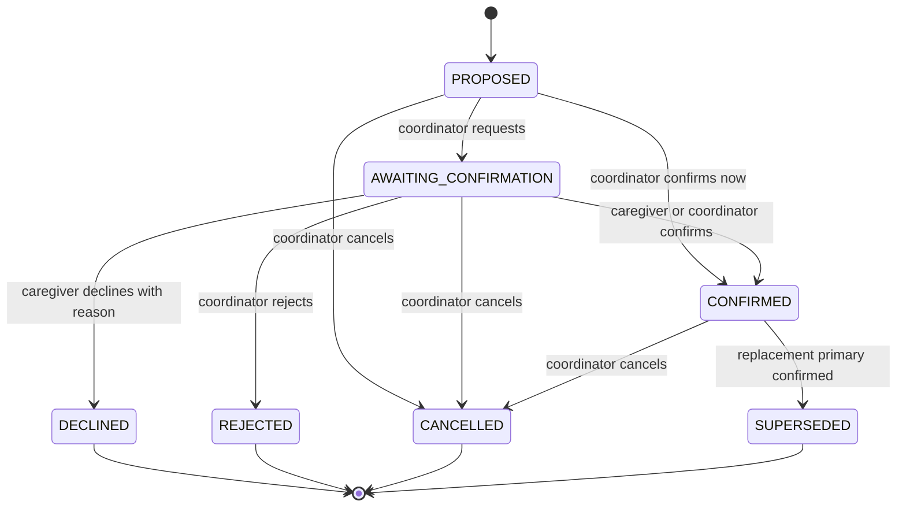

# CareCircle

## 1. Project name, team details, and a short solution summary

**Project:** CareCircle. **Team:** CodeBlue — Aditya Prasad, Gaspar Anothony Savio Simoes, Pusapati Nikhil, and Shrivas Shetty.

CareCircle coordinates medication doses, appointments, caretaker assignments and replacement cover. Patients, primary contacts, caretakers and healthcare professionals share role-specific views of completed, pending and missed care activities. All demo people are fictional.

## 2. Architecture and technology stack

React and TypeScript provide the UI, with Vite, Tailwind CSS, React Router and TanStack Query. Python/FastAPI handles APIs, authentication and deterministic coordination rules. SQLAlchemy and psycopg connect to PostgreSQL 16; Alembic manages migrations. FastAPI serves the built UI and API together on port 8000. A background worker handles escalation timers, missed activities and cover coordination. See [Architecture](docs/ARCHITECTURE.md) and the current [Product spec](docs/PRODUCT_SPEC.md).

## 3. Supported environments and dependencies

Docker Compose is the supported deployment on Windows with Docker Desktop, or Linux/macOS with Docker and Compose. PowerShell and shell helper scripts are included. Python 3.11+ (3.12 recommended) runs local helpers and the backend fallback; Node.js 20.19+ is needed when building the frontend locally. Backend dependencies are listed in `backend/requirements.txt`, frontend dependencies in `frontend/package.json`. Initial image/dependency downloads need internet; the built application bundles its UI assets and fonts for offline LAN use.

## 4. Installation and run commands

From the repository root, with Docker running:

```powershell
.\scripts\start.ps1
```

The Windows start script creates `.env` with a generated session secret if it does not exist. On Linux/macOS, use `bash scripts/start.sh`. With `.env` already configured, direct Compose commands are:

```sh
docker compose up --build -d
docker compose logs -f app
docker compose down
```

For the local SQLite fallback on Windows, run `.\scripts\run-local.ps1`; this requires local Python and Node.js.

## 5. Deployment method and access instructions

Docker Compose runs separate application and PostgreSQL containers. A named `pgdata` volume persists the database across normal restarts and `docker compose down`. The app listens on `0.0.0.0:8000`; PostgreSQL's published port is restricted to the host's `127.0.0.1:5432`.

- Laptop: [http://localhost:8000](http://localhost:8000).
- API documentation: [http://localhost:8000/docs](http://localhost:8000/docs).
- LAN devices: `http://<laptop-LAN-IP>:8000` on the same Wi-Fi/hotspot. Run `python scripts/lan-info.py` to find the URL.
- If Windows blocks LAN access, run `.\scripts\open-firewall.ps1` once from Administrator PowerShell in the project folder. Networks with client isolation may still block access.

**Hosted deployment.** For a public or shared deployment with HTTPS (needed for the microphone off `localhost`), use `docker-compose.prod.yml`, which adds Caddy for TLS, a private database network, health checks and restart policies. `scripts/deploy.sh` backs up, builds, switches, verifies and rolls back automatically. Follow the step-by-step guide and release strategy in [docs/DEPLOYMENT.md](docs/DEPLOYMENT.md). For a managed public URL, `render.yaml` and [docs/DEPLOY_RENDER.md](docs/DEPLOY_RENDER.md) cover the platform choice (Render recommended; Vercel is not suitable for the backend) and the exact steps.

## 6. Environment variables and safe example configuration

[.env.example](.env.example) contains placeholder/demo values, with no real API keys. Keep the local `.env` untracked. For manual setup, copy `.env.example` to `.env` and replace `SECRET_KEY` with a randomly generated secret before use.

| Variables | Purpose |
|---|---|
| `APP_ENV`, `SECRET_KEY` | Runtime environment and JWT signing secret |
| `DATABASE_URL` | Database connection; Compose supplies its internal PostgreSQL URL |
| `APP_TIMEZONE` | Display/scheduling timezone, default `Asia/Kolkata` |
| `DEMO_MODE`, `SEED_DEMO`, `DEMO_POPULATION`, `DEMO_PASSWORD` | Fictional demo behavior, seeding and account password |
| `AUTO_COORDINATION`, `ESCALATION_TIME_SCALE` | Automatic cover and demo escalation timing |
| `COOKIE_SECURE`, `SESSION_HOURS` | HTTPS-only cookie setting and session lifetime |
| `LOG_LEVEL`, `GIT_SHA` | Logging and build identification |
| `GEMINI_API_KEY`, `GROQ_API_KEY`, `GEMMA_MODEL`, `GEMINI_SPEECH_MODEL`, `GROQ_STT_MODEL`, `GROQ_TEXT_MODEL`, `AI_SPEECH_ORDER`, `AI_TEXT_ORDER` | Optional, advisory AI for voice notes (speech to text, translation, urgency suggestion). Empty keys disable it; see [docs/AI.md](docs/AI.md) |
| `PORT`, `FORWARDED_ALLOW_IPS` | Listening port (set by hosting platforms) and whether to trust the platform proxy for client IP and scheme |
| `FEATURES`, `RUN_SCHEDULER` | Staged rollout allow-list of features, and whether this instance runs the scheduler (only one ever does, enforced by a database lock) |
| `AI_PROVIDER`, `AI_API_KEY`, `AI_MODEL` | Unused legacy settings |

The example database credentials and demo password are for fictional local demonstrations. Production deployment requires separate credentials, HTTPS and appropriate secret management.

## 7. Database setup and test instructions

Docker initializes PostgreSQL, waits for database readiness, applies `alembic upgrade head`, and seeds enabled fictional demo data. No manual table creation is needed. The larger population is controlled by `DEMO_POPULATION`; the demo reset preserves it. SQLite is used for local backend tests.

With backend dependencies installed in your Python environment, run from the repository root:

```sh
python -m pytest backend/tests -q
```

From `frontend/`, with dependencies installed using `npm ci`:

```sh
npm run lint
npm run typecheck
npm test
npm run build
```

Against the running deployment, from the repository root:

```sh
python scripts/smoke.py --base-url http://<LAN-IP>:8000
python scripts/load_check.py --base-url http://<LAN-IP>:8000 --users 40 --seconds 20
```

The smoke check creates test records; the load check uses seeded demo accounts and currently expects the default demo password. Do not use `docker compose down -v` unless you intend to delete the persisted database volume.

## 8. Known limitations

- This is an operational coordination demo, not a diagnostic or emergency service; use fictional data only.
- Default LAN deployment uses HTTP. HTTPS, professional identity verification, multi-factor authentication and configured encryption at rest are not implemented by this setup.
- Alerts (pop-ups, sound, desktop notifications, reminders) appear while CareCircle is open in a browser; web push and SMS to a closed phone are not implemented. Screens poll for updates. AI is optional and advisory; accuracy for real speakers has not been measured.
- The scheduler runs in one application process (a database lock keeps a second instance from also running it); multi-worker web serving is not configured. Forecasts cover up to seven days and do not calculate real travel times.
- Vite/Vitest can encounter module-resolution problems when the project path contains `#`, as in `M#`; use a checkout path without that character for local frontend testing.
- Earlier documentation below is retained as project history. Some phase sections describe roles or features superseded by the current [Product spec](docs/PRODUCT_SPEC.md).

---

CareCircle puts every **medication dose** and **appointment** for a patient in one place, so the **caretaker** no longer has to remember them, and the family and the hospital can see what was done, what is due and what was missed.

- **Four roles.** The **patient**; a **primary contact** (a blood relative) who registers the patient and oversees care; **caretakers**, who carry out the care activities; and **healthcare professionals** from the hospital.
- **Hospital data feeds.** Professionals find a registered patient by their CareCircle ID and birth year, then **prescribe medicines** and **schedule appointments**.
- **Status.** Each dose and appointment is *pending*, *completed* or *missed*, judged against the clock.
- **Automatic cover.** When a caretaker takes leave or is overloaded, CareCircle asks the best eligible caretaker to cover, and the task counts as covered only once they accept.

The product spec is in [docs/PRODUCT_SPEC.md](docs/PRODUCT_SPEC.md). For a 10-minute walkthrough, follow [docs/DEMO_SCRIPT.md](docs/DEMO_SCRIPT.md).

Team: CodeBlue: 

Aditya Prasad,

Gaspar Anothony Savio Simoes,

Pusapati Nikhil,

Shrivas Shetty

**The caregiver is the second patient.**

## Quick start

Requirements: Docker Desktop with Compose and Python 3.11+ (3.12 recommended). From the repository root:

```powershell
Copy-Item .env.example .env # optional; scripts/start.ps1 creates it and generates SECRET_KEY
.\scripts\start.ps1
```

Or run `docker compose up --build -d` after creating `.env` from `.env.example`. The Compose app serves the API and bundled React UI from port 8000. Stop with `docker compose down` or `.\scripts\stop.ps1`. Demo accounts use `DEMO_PASSWORD` (default `Demo@1234`).

### Access URLs

- This laptop: [http://localhost:8000](http://localhost:8000)
- API docs: [http://localhost:8000/docs](http://localhost:8000/docs)
- Health: [http://localhost:8000/api/health](http://localhost:8000/api/health)
- Other LAN devices: run `python scripts/lan-info.py` and open the printed current Wi-Fi `http://<LAN-IP>:8000` URL. The address can change when Wi-Fi or hotspot reconnects. If the Windows firewall rule is missing, open PowerShell as Administrator, go to this project, and run `.\scripts\open-firewall.ps1` once. It allows inbound TCP 8000 only from the local subnet, including when a phone hotspot is classified as Public. Both devices must share the same Wi-Fi/hotspot. Networks with client isolation can still block device-to-device connections.

For emergency use without Docker, `.\scripts\run-local.ps1` builds the frontend and runs FastAPI with local SQLite. Docker + PostgreSQL is the supported deployment. Development: run backend Uvicorn on :8000, then `npm run dev` from `frontend/` (Vite :5173 proxies `/api`).

## Phase 1 — Foundation, Auth & LAN Deployment

### Built

- FastAPI backend with SQLAlchemy models and initial Alembic migration for users, patients, patient care teams, and audit history; PostgreSQL deployment and SQLite local/test path.
- Cookie-based JWT sessions, Argon2 passwords, family-only self-registration, role reload on each request, session versioning, logout and password change, CSRF header enforcement, and login throttling.
- Patient and care-team endpoints with membership authorization, coordinator restrictions, role compatibility checks, last-coordinator protection, and filtered clinical notes.
- Synthetic demo users (`users.is_synthetic`) and two synthetic patients (`patients.is_synthetic`) with shared househelp on both care teams. `DEMO_PASSWORD` can be changed from the default.
- Responsive family dashboard, role badge and demo sign-in chips, patient/care-team/history/system status loaded from the API, tokenized CSS, bundled Inter fonts, and operational disclaimer.
- Docker Compose on port 8000, LAN address helper, start/stop scripts, Windows firewall helper, no-Docker fallback, smoke script, project rules, and architecture/roadmap documentation.

### API endpoints

| Endpoint | Purpose |
|---|---|
| `GET /api/health` | API and database liveness |
| `GET /api/v1/meta` | Version, phase, demo mode, timezone, server time |
| `POST /api/v1/auth/register` | Create FAMILY account and sign in |
| `POST /api/v1/auth/login` | Sign in; rate limited |
| `POST /api/v1/auth/logout` | Clear session cookie |
| `GET /api/v1/auth/me` | Current DB-backed user |
| `POST /api/v1/auth/change-password` | Change password and invalidate prior sessions |
| `GET/POST /api/v1/patients` | List accessible patients / create patient |
| `GET/PATCH /api/v1/patients/{id}` | Read/update patient profile |
| `GET/POST /api/v1/patients/{id}/care-team` | List/add existing account to team |
| `DELETE /api/v1/patients/{id}/care-team/{member_id}` | Remove member subject to coordinator rule |
| `GET /api/v1/patients/{id}/history` | Paginated audit history |
| `POST /api/v1/admin/demo/reset` | Admin-only reset while demo mode is enabled |

All state-changing requests require `X-Requested-With: second-patient`. The browser API client sends it automatically. Unauthorized patient lookups return 403; unknown IDs return 404. Inputs reject unknown fields. Error responses use the common `error` envelope and request ID. The dashboard is live for family/admin demo accounts; remaining portal routes are marked for later phases.

### Audit notes

- ✅ **Repository and docs:** `.env` is ignored and not tracked; `.env.example` includes the settings declared in `Settings`; `.gitattributes` sets LF for shell scripts, Dockerfile, and entrypoint. Added `*.tsbuildinfo` and `.vite/` to ignore rules during this audit. The test-account table lists all eight seeded accounts and identifies the configured `DEMO_PASSWORD` as their password.
- ✅ **Security implementation review:** middleware enforces the CSRF header on state-changing methods and adds CSP/security headers; session cookies use HttpOnly and SameSite=Lax; unexpected errors return the common envelope without a stack trace. Runtime/browser-console confirmation is still needed.
- ✅ **Client URL review:** frontend API calls use relative paths and fonts are bundled locally; no CDN is configured in the app source.
- 🔧 **LAN guidance:** the address helper now lists candidate URLs, warns about networks outside known hotspot ranges, and optionally prints QR codes when `qrcode` is installed. Second-device access remains a manual network check.
- ⚠️ **Coverage and role landing:** the original 11-test suite did not cover every audit item (notably the complete permission matrix, all IDOR combinations, seed/reset edge cases, and forced-500 behavior). The role navigation is present for all eight seeded users in the frontend, but a browser-level redirect/nav check across every account has not been recorded. Run the checks in `Test Instructions` and inspect the browser console before claiming those items verified.
- ⚠️ **Clean-slate persistence:** perform `docker compose down -v`, rebuild/start, then restart and verify seed idempotency on a machine with Docker access. A real second-device LAN check is also required to verify the chosen network permits client-to-client traffic.

### Security and design decisions

- Demo accounts are isolated examples; newly registered users always receive FAMILY role. Roles are never accepted by the registration schema.
- Sessions live in an HttpOnly, SameSite=Lax cookie. `COOKIE_SECURE=false` supports plain HTTP LAN demos; use HTTPS and enable it when deployed behind TLS.
- User records are reloaded on each authenticated request; inactive accounts and changed token versions invalidate sessions.
- Patient data is scoped through care-team membership. Clinical notes are omitted for househelp. Audit history records patient/profile and team changes.
- The starting local database is SQLite; PostgreSQL 16 is the Compose path. An ordered idempotent seed registry holds phase data. `Base.metadata.create_all` is also kept available for test/local initialization; Alembic tracks schema revisions.
- Phase 1 has no AI features (`ai_enabled=false`). Decision engine, care-gap scoring, backup filtering, and confirmation workflow are later phases and will be deterministic backend code.

### Test and LAN verification

```powershell
python -m pytest backend/tests -q
python scripts/smoke.py --base-url http://localhost:8000
cd frontend; npm run lint; npm run typecheck; npm test; npm run build
```

For a second device, start the app, run `python scripts/lan-info.py`, ensure both devices share the same Wi-Fi/hotspot, run the Windows firewall helper if needed, then open the printed LAN URL in that device's browser. A second-device check requires a real second device and is not claimed as verified by repository tests.

## Architecture & Stack

See [docs/ARCHITECTURE.md](docs/ARCHITECTURE.md) for the full stack, security contracts, target domain, and phase roadmap. Phase 1 uses FastAPI, SQLAlchemy, Alembic, PostgreSQL 16 (SQLite for tests/local fallback), React 18, Vite, TypeScript, TanStack Query, and bundled Inter font assets.

## Supported Environments

Docker Compose on Windows, macOS, or Linux with Docker Desktop/Engine; same-network modern browsers including phones. Development requires Node 20 and Python 3.11+ (recommended 3.12). LAN use over plain HTTP is intended for trusted demo networks.

## Environment Variables

Copy `.env.example` to `.env`; `scripts/start.*` makes a local copy and generates a random secret if none exists.

| Variable | Default | Purpose |
|---|---|---|
| `APP_ENV` | `dev` | Runtime mode (`dev` / `prod`) |
| `SECRET_KEY` | safe placeholder | JWT signing key; change for production |
| `DATABASE_URL` | PostgreSQL Compose URL | SQLAlchemy database connection |
| `APP_TIMEZONE` | `Asia/Kolkata` | Display/application timezone |
| `DEMO_MODE` | `true` | Enables synthetic demo and guarded reset |
| `SEED_DEMO` | `true` | Seed demo accounts and patients at startup |
| `DEMO_PASSWORD` | `Demo@1234` | Password for every seeded account |
| `ESCALATION_TIME_SCALE` | `1.0` | Timer scale in demo mode only; `0.1` shortens minute timers to seconds |
| `COOKIE_SECURE` | `false` | Set true when served over HTTPS |
| `SESSION_HOURS` | `12` | Session duration |
| `LOG_LEVEL` | `INFO` | Server logging level |
| `AI_PROVIDER` | `none` | Reserved for Phase 8 |
| `AI_API_KEY` | empty | Reserved for Phase 8; unused now |
| `AI_MODEL` | empty | Reserved for Phase 8; unused now |
| `GIT_SHA` | `dev` | Build identifier surfaced in metadata |

## Database Setup

Compose starts PostgreSQL 16 with a named `pgdata` volume. The database port is bound to `127.0.0.1`; the web app is exposed on all host interfaces at 8000. Alembic runs on container start. `docker compose down` retains data; `docker compose down -v` deletes the database volume. The local fallback uses `./second_patient.db` SQLite.

## Test Instructions

Backend: `python -m pytest backend/tests -q` (set `PYTHONPATH=backend` if your pytest environment does not read `backend/pyproject.toml`). Frontend: run `npm ci`/`npm install`, then `npm run lint`, `npm run typecheck`, `npm test`, `npm run build` from `frontend/`. Deployment smoke: `python scripts/smoke.py --base-url http://localhost:8000`; run the same command with the server laptop LAN URL for network verification. Smoke creates a random test account and patient.

## Test Accounts

All accounts below are synthetic; all use the configured `DEMO_PASSWORD`.

| Role | Email | Notes |
|---|---|---|
| Primary contact | `anita.iyer@secondpatient.demo` | Ramesh Iyer's daughter; also helps with care |
| Primary contact | `karthik.iyer@secondpatient.demo` | Ramesh's son; also helps with care |
| Primary contact | `meera.pai@secondpatient.demo` | Sharada Pai's daughter |
| Patient | `ramesh.iyer@secondpatient.demo` | CareCircle ID `CC-RAM354`, born 1954 |
| Caretaker | `savitha@secondpatient.demo` | Ramesh's main caretaker; also helps Sharada |
| Caretaker | `lakshmi@secondpatient.demo` | Weekdays |
| Caretaker | `suresh.kamath@secondpatient.demo` | Neighbour; transport and escort, mornings |
| Healthcare professional | `dr.arjun.nair@secondpatient.demo` | Prescribes Ramesh's Metformin and Amlodipine |
| Healthcare professional | `divya.menon@secondpatient.demo` | Nurse |

Earlier releases had `admin`, `FAMILY`, `HOUSEHELP`, `NURSE` and `DOCTOR` roles. Migration `0009_four_roles` maps them to the four roles above and deactivates the admin account.

## AI Tools Disclosure

Codex was used for code generation and planning. Update this disclosure if Cursor or Claude is used later.

## Third-Party Resources & Licenses

React and React DOM (MIT), Vite (MIT), TypeScript (Apache-2.0), React Router (MIT), TanStack Query (MIT), Lucide (ISC), Inter fonts from @fontsource (SIL Open Font License 1.1), FastAPI (MIT), SQLAlchemy (MIT), Alembic (MIT), Pydantic (MIT), Argon2 bindings (MIT), PyJWT (MIT), psycopg (LGPL-3.0-or-later). PostgreSQL uses the PostgreSQL License; container images retain their upstream licenses. No external CDN assets are loaded. See package metadata and upstream license files for complete terms.

## Synthetic Data Disclosure

All supplied people, care notes, and clinical-looking notes are fictional demonstration data, not real patient records. Seeded user and patient rows set `is_synthetic=true`; self-registered accounts are not marked synthetic. Do not enter real health or identifying data into this demo.

## Known Limitations

CareCircle currently provides the Phase 1/2 foundation and an initial Phase 3 deterministic classifier/message-to-incident path. Time-boxed escalation, complete role portals, absence simulation, and real-time updates are not yet implemented. The reset route clears patient/team/history rows but preserves user accounts. Demo role switching uses pre-seeded accounts. The second-device LAN check is manual; host firewall rules and Wi-Fi client isolation can still prevent access. Login throttling is process-local and resets on restart. Database schema creation includes a create-all safety path alongside the migration baseline. npm audit reports build-only transitive advisories from the requested Tailwind CSS 3.4 toolchain; frontend dependencies are not copied into the runtime image.

---

## Existing Repository Event Guidelines

### Branch Rules
- Each team maintains `main`, `bugbounty`, and `fixing` branches. `main` is ongoing development; `bugbounty` is deployment/peer-testing; `fixing` is bug fixes.
- Keep `main` and `bugbounty` in sync until the Attack Phase. Never delete `bugbounty` or `fixing`.

### Attack Phase
- `bugbounty` freezes at the start of the Attack Phase. Only `bugbounty` is deployed for peer testing. Development may continue on `main`.
- Test only assigned projects and follow event testing rules.

### Fixing Phase
- Create `fixing` directly from `bugbounty` at the beginning of Fixing. Commit fixes only there; keep `bugbounty` frozen.
- Stop fixing commits at 3:30 AM. Merge validated fixes into `main` only after the phase ends. Update `bugbounty` only after organizers announce evaluation is complete.

### Bug Reporting and Safety
- Maximum 10 bug reports overall and 4 per target team. Report critical vulnerabilities or exposed data privately to organizers.
- Do not modify frozen branches, bypass repository restrictions, or perform destructive testing, denial of service, phishing, malware deployment, or tests against unrelated systems.

## Phase 2 — Core Domain: Patients, Caregivers, Availability, Activities, Assignments

Phase 2 expands the patient foundation into a care network and a scheduled plan. Caregivers are separate from login accounts; a caregiver may optionally link to a login and may be shared across patients. The API is the source of truth for permissions, assignments, and warning results. Phase 2 does not detect care gaps or calculate safety/medical risk.

### API added in Phase 2

All routes require authentication. Mutations also require `X-Requested-With: second-patient`. Inputs reject unknown fields where model schemas are used. This adds 32 route operations, including the five assignment transition routes.

| Area | Endpoints | Purpose |
|---|---|---|
| Patients | `GET/PATCH /api/v1/patients/{id}`; `PUT /patients/{id}/support-needs`; `GET /patients/{id}/overview` | Profile fields, support-needs replace-all, next-week summary and recent history |
| Care network | `GET/POST /patients/{id}/caregivers`; `POST/DELETE /patients/{id}/caregivers/{caregiver_id}/link`; `GET/PATCH /caregivers/{id}` | Add, link, inspect, update, and unlink caregivers |
| Availability | `GET/PUT /caregivers/{id}/schedule`; `GET /caregivers/{id}/availability?from&to`; `POST /caregivers/{id}/availability-overrides`; `POST /caregivers/{id}/availability-overrides/{override_id}/cancel` | Weekly windows, effective availability, and cancellable overrides (maximum 90-day query range) |
| Workload | `GET /patients/{id}/caregivers/workload?from&to`; `GET /caregivers/{id}/assignment-history` | Workload by local day/week and caregiver assignment history, with other-patient details masked |
| Activities | `GET/POST /patients/{id}/activities`; `POST /patients/{id}/activities/series`; `GET/PATCH /activities/{id}`; `POST /activities/{id}/cancel|complete`; `POST/DELETE /activities/{id}/dependencies` | List, create, edit, recur, complete/cancel, and connect activities |
| Assignments | `POST /activities/{id}/assignments`; `POST /assignments/{id}/request-confirmation|confirm|decline|reject|cancel` | Assign primary/backup caregivers and move assignment state |

Patient and activity responses include `my_permissions` for UI gating. The patient profile, care network, care plan, and history routes have working Phase 2 screens. Care plan actions display returned warnings. Other role pages remain planned. Time labels and datetime entry use `Asia/Kolkata` independent of the device timezone.

### Availability, overlap, and workload

Weekly schedule windows describe when a caregiver is available. No rows means unavailable. Each row uses a weekday (`0` Monday through `6` Sunday), start minute, and end minute after local midnight. Adjacent intervals merge; overlapping or duplicate rows are rejected by the schedule API. A required activity window includes its before/after buffers and must fit entirely inside effective availability.

An active `UNAVAILABLE` override removes time even when a baseline or `AVAILABLE` override covers it. An active `AVAILABLE` override can add time outside the baseline. Cancelling an override sets `cancelled_at`; the row remains for history. Availability calculations handle midnight and multi-day intervals. `engine/availability.py` returns uncovered portions and the blocking overrides for later explanations.

Overlap uses buffered time windows; intervals that only touch do not overlap. Workload counts primary assignments by the activity's local start date and Monday–Sunday week. Confirmed and pending work are separate. Backup assignments are standby and do not count. Shared-caregiver computations include all patients, but summaries never expose other patients' names or activity titles.

### Assignment state machine



Only one active primary assignment is allowed per activity. A confirm submitted after the state has changed returns `409` consistently. Terminal states cannot change.

### Permission matrix

| Role | Patient plan | Manage plan/network | Own availability and assignment response | Clinical notes |
|---|---|---|---|---|
| Coordinator | Read | Full, for coordinated patients | Yes | Read |
| Family member | Read shared plan | No | Own caregiver only | Read shared notes |
| Househelp / nurse | Own assigned activities | No | Own caregiver/assignment only | No (househelp); nurse can read |
| Patient | Read-only | No | No | Own patient notes |
| Doctor | Read plan/appointments | No | No | Read |
| Admin | All patients | Full | Full | Read |

Caregiver phone numbers are limited to admins, coordinators of linked patients, and that caregiver's own linked login. API permission checks remain authoritative even when a UI control is hidden.

### Blocks and warnings

| Hard block (`4xx`) | Warning returned with success |
|---|---|
| Invalid or backwards time, naive datetime, unknown support code, caregiver not linked/active, assignment on completed/cancelled activity, second active primary, cross-patient or cyclic dependency | Missing caregiver capability, incomplete availability, overlapping caregiver commitment, daily/weekly workload limit, patient activity overlap, deadline less than 24 hours away |

Warnings include a stable `code`, a plain-language `message`, and structured `details`. Phase 3 can reuse the availability and workload calculations to explain care gaps.

### Synthetic walkthrough

The demo seed is relative to the current clock. Anita coordinates Ramesh's plan and is available around the clock. Karthik has a next-day work override from 12:30 to 14:00; Suresh is available mornings. Savitha is shared by Ramesh and Sharada and has daily assistance, medication, mobility, and pickup capabilities but no transport capability. Divya is the nurse backup. The plan includes a cardiology visit and transport, a prescription pickup, a seven-day medication series, a lab trip, post-appointment assistance, and an intentionally unassigned supplies pickup. Sharada has assistance/meal preparation with Savitha and a doctor visit with Meera. Every seeded person and activity is fictional and marked synthetic. No disruption is seeded; the Phase 3/4 demo will add one.

To explore: sign in as `anita.iyer@secondpatient.demo`, open **Patient Profile**, **Care Network**, **Care Plan**, and **History**. The shared demo password is the configured `DEMO_PASSWORD` (default `Demo@1234`). Availability changes and assignments appear in History. Assigning a caregiver without a matching capability is allowed and returns a warning.

### Phase 2 checks and known limitations

```powershell
python -m pytest backend/tests -q
cd frontend; npm run lint; npm run typecheck; npm test; npm run build
cd ..; python scripts/smoke.py --base-url http://localhost:8000
```

The reassessment hook records calls but is deliberately a no-op; care gaps, risk scoring, recommendations, and resolution remain later phases. The web UI provides basic profile, care-network, plan, and history actions; full edit drawers, series controls, caregiver-link management, conflict detail UI, and all role-specific portals are not complete. The smoke script uses a freshly registered user's own patient. A second-device LAN check remains manual and requires a network that permits client-to-client connections.

## Phase 3 — Escalation Engine & Patient Messaging

CareCircle branding, role display labels, revised product direction, and the Phase 3 metadata are now live. The deterministic classifier is a pure backend module with English, Hindi, Kannada, and Telugu phrase coverage, explicit L0–L5 routing levels, safety modifiers, SOS override, unknown-text fallback to L2, and a raise-only advisor interface. Its table-driven test covers 84 classifier examples across the supported languages and scripts. Alembic adds patient messages, incidents, incident events, and notifications. Authenticated patient/care-team APIs accept messages and SOS reports, save a safe summary, create role-routed in-app notifications, and expose incident summaries, acknowledgement, resolution, and a user's notification list. Message text is omitted from audit history and notification content.

A single-worker, 15-second backend tick advances due incidents using persisted acknowledgement and resolution deadlines, severity multipliers, category caps, a configurable quiet-hours policy, and a demo-only time scale. Role-filtered incident summaries, acknowledgement, manual raise/lower with reasons, policy read/update/reset APIs, scheduled-activity acknowledgement/overdue detection, and a task-ack endpoint are included. The patient Help page has quick replies, text entry, a cancellable SOS countdown, status polling, and 108/112 links; the Incident Center has role-filtered lists, one-tap acknowledgement, escalation deadline display, and an unacknowledged emergency banner. The notification bell, policy editor, and admin speed/scenario panel are also implemented. Remaining work includes backup offers and decision cards, nurse visit and doctor instruction flows, doctor summary, SSE, digest generation, offline queue, multilingual UI, full-screen alert/audio experience, detailed incident action cards, and the complete clinical role portal workflows. See [docs/ESCALATION.md](docs/ESCALATION.md) for implemented behavior and limits. Lexicons are machine-drafted and require native-speaker review before real use.

### Available endpoints

| Endpoint | Purpose |
|---|---|
| `POST /api/v1/patients/{id}/messages` | Submit a patient message (`Idempotency-Key` supported) and create a routed incident |
| `POST /api/v1/patients/{id}/sos` | Create an L5 SOS incident |
| `GET /api/v1/incidents?patient_id=...&status=OPEN` | List patient-safe incident summaries for accessible care teams |
| `GET /api/v1/incidents/{id}` | Read an authorised incident and timeline (patient timelines are redacted) |
| `POST /api/v1/incidents/{id}/acknowledge` | Claim an open incident |
| `POST /api/v1/incidents/{id}/escalate` | Human raises the routing level with a reason |
| `POST /api/v1/incidents/{id}/lower` | Permitted primary contact or care professional lowers the level with a reason and audit entry |
| `POST /api/v1/incidents/{id}/resolve` | Resolve with a code; L5 requires acknowledgement and a note |
| `GET /api/v1/notifications?unread=true` | List the signed-in user's in-app notifications |
| `POST /api/v1/notifications/{id}/read` | Mark an owned notification read |
| `GET/PUT /api/v1/patients/{id}/escalation-policy` | Read or update role-authorized per-patient timer and quiet-hour settings |
| `POST /api/v1/patients/{id}/escalation-policy/reset` | Restore the system policy |
| `POST /api/v1/activities/{id}/acknowledge` | Acknowledge an assigned primary caregiver activity |
| `POST /api/v1/admin/demo/escalation-speed` | Set the demo-only timer scale |
| `POST /api/v1/admin/demo/scenarios/{name}` | Run or reset a synthetic escalation scenario |
| `GET /api/v1/meta` | Reports CareCircle and phase 3 |

All mutation routes require authentication and the existing CSRF header. The required success path to try is sign in as the synthetic patient, POST “I need water”, then inspect the incident as a care-team account, acknowledge, and resolve. Repeat with `/sos` to confirm L5 creation. Demo accounts are listed above; use the configured `DEMO_PASSWORD`.

### Phase 3 test instructions and verification

Run the backend and frontend commands in [Test Instructions](#test-instructions), then run the smoke script against localhost and the host LAN address. The Phase 3 smoke extension is in `scripts/smoke.py`. The earlier verification record below was current at Phase 3; the Phase 4 run is recorded in the Phase 4 section. A real second-device check remains manual. Manual emergency demo: submit a chest-pain message or SOS and confirm the L5 record and notification; use phone emergency services directly for any real emergency.

### Manual escalation demo

1. Sign in as Anita and open **Escalation Policy** for Ramesh. Set L1 and L2 acknowledgement timers to 1 minute, then save.
2. Sign in as Admin and set the demo timer scale to `0.1` in **Admin demo panel**. Keep Anita and Savitha open in separate browser sessions.
3. Run `daily_help`, or sign in as Ramesh in another session and send “I need water”. Confirm the request appears as L1 for Savitha (or L2 if no caretaker login is available). Leave it unacknowledged and watch the Incident Center advance to L2 and then L3.
4. Run the `sos` scenario and confirm the L5 banner and 108/112 links. This is an in-app demonstration only; it does not contact emergency services.

Preflight on 2026-10-14 found the local shell did not have a `python` alias or host pytest, and the frontend dependency tree was initially absent. Docker Compose was initially unavailable because the ignored `.env` file was absent. A later Docker run passed 146 backend tests and 32 smoke checks; the frontend suite passed 5 tests. These were the Phase 3 baseline results, not Phase 4 verification. Create `.env` from `.env.example` before starting Compose.

## Phase 3 decisions

- Unknown or ambiguous text routes to L2 `UNCLASSIFIED`; only explicit positive patterns may route to L0.
- The SOS shortcut overrides message classification to L5. The patient Help page includes a three-second cancellable countdown and direct `tel:108` / `tel:112` links.
- Initial routing uses care-team roles; a 15-second single-worker service applies persisted deadlines and records each transition. There is no SMS or phone integration.
- Safe summaries are deterministic from patient name, message category, and time. Raw message text stays in the message table and is omitted from audit and notification payloads.
- Role labels are display-only; stored enum values, package names, database names, environment names, and demo emails remain stable.

## Phase 4 — Caregiver Command Center

### Starting point inventory

- `/api/v1/meta` reported Phase 3, version 0.3.0. Git history included the Phase 1 foundation, Phase 2 care domain, Phase 3 message/escalation work, and later authentication and LAN fixes. The working tree was clean at preflight.
- README contained cumulative Phase 1–3 sections. Existing models and migrations covered users, patients, care-team memberships, activities, caregivers, schedules, overrides, assignments, incidents, messages, notifications, and escalation timers; migrations ended at `0005_escalation_timers.py`.
- Pure `engine/availability.py` and `engine/workload.py`, classifier/escalation engines, and the Phase 2 `services/reassess.py` hook existed. The 15-second single-worker scheduler existed. There was no SSE stream, frontend i18n dictionary, or existing Command Center.
- Phase 4 adds `0006_command_center.py`, deterministic attention and daily-plan modules, action-item reconciliation, template briefs, role-scoped APIs, and a polling UI. The existing incident and notification models are reused; no parallel incident system was added.
- Baseline frontend checks passed. The Phase 4 initial Docker/smoke baseline could not be started from this environment because the Docker socket was denied in the sandbox and the requested elevated invocation was rejected. Phase 4 final test and Docker results are recorded after implementation below.

### What changed

The Command Center is the landing page for primary contacts and administrators; househelp and nurses receive the same route as a reduced My Day. It leads with needs-now and decisions, shows at-risk items and a grouped daily plan, keeps reminders on the server, and provides morning and handover briefs. The screen displays the as-of time and the honest basis note on every view. Nothing in this phase represents a diagnosis or a wellbeing check.

The backend computes action items deterministically from the care schedule, assignments, availability, capability, workload, incidents, and handover state. Derived items are idempotent, auto-resolve when their condition clears, reopen after a suppression interval when still present, and wake after snooze. The existing reassess hook and escalation mutations reconcile within their transaction; the scheduler catches up briefs and time-driven transitions. Briefs use deterministic templates and escaped HTML. Details and limits are documented in [docs/COMMAND_CENTER.md](docs/COMMAND_CENTER.md).

### New endpoints

| Endpoint | Purpose |
|---|---|
| `GET /api/v1/command-center?patient_id=&date=` | Role-scoped dashboard snapshot, action buckets, daily plan, load, and briefs |
| `GET /api/v1/command-center/overview` | Authorized coordinator/admin multi-patient counts |
| `GET/POST /api/v1/action-items?patient_id=&status=` | List action items or add a manual reminder |
| `POST /api/v1/action-items/{id}/act` | Execute a supported one-tap action through existing domain routes |
| `POST /api/v1/action-items/{id}/snooze`, `/done`, `/dismiss` | Snooze, resolve a reminder, or suppress a dismissible item |
| `GET/POST /api/v1/patients/{id}/briefs` | List briefs; generate a morning brief or draft a handover |
| `GET/PUT /api/v1/briefs/{id}` | Read JSON/text/HTML or edit a draft handover |
| `POST /api/v1/briefs/{id}/publish`, `/acknowledge` | Publish or acknowledge a handover |
| `GET/PUT /api/v1/patients/{id}/command-center/settings` | Read or update per-patient brief and attention defaults |
| `POST /api/v1/admin/demo/scenarios/command_center_messy_day` | Add synthetic same-day missing-coverage and pending-confirmation work |
| `POST /api/v1/admin/demo/scenarios/command_center_clear_day` | Cancel the synthetic Command Center scenario activities |

### Three-minute demo

1. Sign in as Anita (`anita.iyer@secondpatient.demo`) with the configured demo password. The Command Center opens with live synthetic data and the as-of/basis text.
2. Sign in as Admin and use **Admin → Command Center · messy day**. Return to Command Center and review the unassigned pickup and pending caregiver confirmation. The scenario is idempotent; use **Clear Command Center demo day** to cancel its activities.
3. Expand a routine block, add a “Call pharmacy” reminder, refresh the page, then snooze or complete the reminder.
4. Generate and copy a morning summary. Create an end-of-day handover, review its text, publish it, and acknowledge it as the listed recipient.

### Phase 4 decisions and limits

- Existing incidents and notifications are integrated. No `EventPublisher` port was needed because the repository had no SSE stream; the frontend polls every 15 seconds.
- The phase implements a basic deterministic exception provider. Full cross-patient eligible-backup ranking, N-1/N-2 resilience scoring, true caregiver-specific free-window calculation, complete batching assignment, all My Day task actions, and the full severity-based 1-tap candidate controls remain Phase 5/6 work.
- The exception taxonomy, role privacy, suppression rules, brief lifecycle, and extension points are recorded in [docs/COMMAND_CENTER.md](docs/COMMAND_CENTER.md). Phase 5 replaces the basic provider through the same `AttentionItem` boundary; Phase 6 can reuse the handover records.

### Phase 4 checks and verification

Run `python -m pytest backend/tests -q`, `npm run lint`, `npm run typecheck`, `npm test`, and `npm run build` from `frontend/`. Run `docker compose up --build -d`, then `python scripts/smoke.py --base-url http://localhost:8000` and repeat with the host LAN IP. The smoke test now exercises command-center retrieval, reminder creation/snooze/done, morning text export, and handover draft/publish/acknowledgement.

Phase 4 verification on 2026-10-14: backend `./.venv/bin/python -m pytest backend/tests -q` passed **152 tests**; frontend lint, typecheck, **5 Vitest tests**, and production build passed. `python3 -m compileall` and `git diff --check` passed. A fresh SQLite Alembic upgrade through `0006_command_center` passed. The Docker image built with its embedded backend and frontend checks. Host port 5432 was already occupied, so Compose was started with a temporary override mapping Postgres to `127.0.0.1:55432`; the app remained bound to `0.0.0.0:8000`. Smoke checks passed **41/41** at both `http://localhost:8000` and the host LAN URL `http://10.72.6.190:8000`. The LAN helper warned that this network may isolate clients. The second device itself was not available for a direct browser check, so cross-device access on the target hotspot remains unconfirmed.

## Feature — Workload Balancer

### What changed

Primary contacts get a **Workload Balancer** screen (`/workload`). It reviews the next 7, 14 or 28 days and shows four things:

- each caregiver's load against their own daily-task and weekly-hour limits, including commitments for other patients (counted only, never named);
- days with high demand against the network's open task slots;
- dependency on one person, or on the only qualified person, for a support need;
- ranked, explained suggestions for moving tasks.

Every task falls into one delegation class: **general** (any capable caregiver), **trained caregiver** (medication or mobility assistance), or **healthcare professional only** (clinical visits, nurse caregivers only).

A suggestion changes nothing until the primary contact taps it. The server then re-checks capability, qualification, availability, overlaps and limits before moving the task. **Ask … to confirm** sends one inbox request, and the plan shows *Not confirmed* until the caregiver accepts. **Move & confirm now** is for a caregiver who has already agreed. Rules, scoring and limits are documented in [docs/WORKLOAD_BALANCER.md](docs/WORKLOAD_BALANCER.md).

### New endpoints

| Endpoint | Purpose |
|---|---|
| `GET /api/v1/patients/{id}/workload-balance?days=7` | Caregiver loads, demand by day, dependency findings, ranked recommendations, delegation rules |
| `POST /api/v1/patients/{id}/workload-balance/apply` | Coordinator applies a move (`REQUEST_CONFIRMATION` or `CONFIRM_NOW`) after server re-validation |

### Demo

Sign in as Anita and open **Workload Balancer**. Tomorrow she has four tasks against a limit of three. The balancer suggests giving *Transport to hospital* to Karthik and explains why Divya and Savitha were ruled out. It also flags Divya's weekend nurse visit as outside her recorded availability. Tap **Ask Karthik Iyer to confirm** and the overload clears.

### Decisions and limits

- No schema change: the feature reads existing caregivers, schedules, overrides, activities and assignments.
- Eligibility, scoring and every recommendation come from deterministic backend logic; the UI only displays them. Professional-only tasks are matched by recorded caregiver kind and capability, not by clinical judgement.
- Tasks starting within two hours are never suggested and are refused on apply. **Ask to confirm** never drops confirmed cover: the previous caregiver stays as a confirmed standby backup until the new caregiver confirms, and is released automatically then.
- Travel time between tasks is not modelled yet; it belongs to the Phase 5 resilience work.

### Checks

`python -m pytest backend/tests -q` adds 15 Workload Balancer tests: 9 engine tests and 6 API tests covering role access, privacy masking, stale-apply rejection, re-validation, standby handoff, the two-hour rule, and notifications. `npm test` adds label-helper tests. The smoke script also calls the balancer endpoint.

## Feature — Capability-Aware Backup Matcher

### What changed

When a caregiver declines a task or reports an absence, CareCircle opens a **cover request** automatically, with no searching or phone round needed to begin.

- **Ranking:** it checks every linked caregiver for capability, qualification (professional-only tasks), availability in the task window, overlapping commitments including travel buffers, and daily or weekly workload. Eligible people are ranked by suitability and continuity: already the backup, has done this recurring task, or has recently supported the patient.
- **Explanation:** each person gets a one-sentence reason, e.g. “Suresh Kamath can provide transport and is available 09:00–10:00” or “Savitha is available but lacks the transport capability”.
- **Asking:** the primary contact taps **Ask** on the best match. If that person says no, the next best match is asked automatically.
- **Covered:** the task counts as covered only after the replacement accepts and a confirmed assignment exists.
- **Measures:** **time to secure a replacement** and **% of gaps resolved without manual searching** are reported on the screen and by the API.

Caregivers can say **I can't make it** on their own task in Care Plan; they stay on it until a replacement confirms. Command Center buttons now go straight to the right flow (**Find cover**, **Rebalance**, **Request confirmation**). Rules, scoring, lifecycle and access are documented in [docs/BACKUP_MATCHER.md](docs/BACKUP_MATCHER.md).

### New endpoints

| Endpoint | Purpose |
|---|---|
| `GET /api/v1/patients/{id}/cover-requests?status=` | Open/closed cover requests with live ranking |
| `GET /api/v1/patients/{id}/cover-requests/metrics?days=30` | Time to secure and matcher resolution rate |
| `POST /api/v1/activities/{id}/cover-requests` | Primary contact asks for cover |
| `GET /api/v1/cover-requests/{id}` | Detail, ranking and event trail |
| `POST /api/v1/cover-requests/{id}/offer`, `/accept`, `/decline`, `/cancel` | Offer → accept/decline (auto-advance) → close |
| `GET /api/v1/cover-offers/mine` | Offers waiting for the signed-in caregiver |

### Demo

Sign in as Karthik. In Care Plan, tap **I can't make it** on *Lab visit*. Then sign in as Anita and open **Cover Requests**. Two of four people can take it, and each person has a stated reason. Tap **Ask Suresh Kamath**, then **Record yes**, and the task is covered. The metrics now show the time to secure and 100% resolved through the matcher.

### Decisions and limits

- Migration `0007_backup_matcher` adds `cover_requests` and `cover_request_events`, plus a partial unique index allowing one open request per task.
- Detection runs in the existing `reassess` transaction and the 60-second scheduler, for tasks up to 60 days ahead. It is idempotent per decline or absence, and a request the coordinator closes does not reopen.
- Unanswered offers time out (at most 2 hours) and move on. If the next match does not use the app, primary contacts get a single “Please call …” prompt.
- Travel is modelled through each task's before/after buffers and a 30-minute tight-connection rule. Real travel time needs locations, which are not recorded yet.
- People without the app (for example a neighbour) are handled by the primary contact recording their yes or no. Notifications are in-app only.

### Checks

`python -m pytest backend/tests -q` adds 12 Backup Matcher tests: 6 engine tests (including the example scenario) and 6 API tests. The API tests cover the decline → auto-advance → covered flow, a caregiver's self-accept, idempotent detection, an absence being withdrawn, manual-cover measurement, expiry, re-validation and access. `npm test` adds label and formatting helper tests. The smoke script opens and closes a cover request.

## Feature — Predictive Coverage Planner

### What changed

A **Coverage Forecast** screen looks at the next **24 hours, 3 days and 7 days**. It uses known schedules, availability, capabilities, commitments and limits (the same rules as the Backup Matcher) and flags three kinds of task:

- **gaps:** no caregiver, or the assigned caregiver cannot actually do it;
- **unconfirmed tasks;**
- **single points of failure:** covered, but the holder is the only eligible person.

Each finding carries a **secure-by** deadline (critical 72 h, high 48 h, medium 24 h, low 12 h ahead, kept within waking hours) and a one-tap step: **Find cover**, **Request confirmation**, or **Ask … to stand by**. Days are rated for capacity. An “if someone is away” list shows what would have no alternative. Example: “Monday's Appointment is covered, but Savitha is the only eligible person. Arrange a backup before Sat 17 Oct, 10:00.” Details are in [docs/COVERAGE_PLANNER.md](docs/COVERAGE_PLANNER.md).

### Measures

A findings log records when each risk was first seen and how it ended. From it the screen reports **future gaps identified before their deadlines** (count, %, median warning time) and **preventable uncovered activities** (flagged in advance but still uncovered at start), plus the share of gaps closed before the task started.

### New endpoints

| Endpoint | Purpose |
|---|---|
| `GET /api/v1/patients/{id}/coverage-forecast` | Forecast for 24 h / 3 d / 7 d with findings, days and the N-1 list |
| `GET /api/v1/patients/{id}/coverage-forecast/metrics?days=30` | Early-warning and prevention measures |

### Decisions and limits

- Migration `0008_coverage_planner` adds `coverage_findings`, with one open row per task and kind.
- The scheduler logs findings every 60 seconds, and so does opening the screen. Actions reuse the Backup Matcher and assignment endpoints; nothing is changed automatically.
- A confirmed backup counts as ready even when over their limit or outside usual hours. Recorded absences, missing skills and clashes still disqualify them.
- Real travel time and recurring-pattern prediction beyond 7 days are not modelled yet.

### Checks

`python -m pytest backend/tests -q` adds 6 planner tests (4 engine, 2 API/log), covering your example sentence, the deadline and waking-hours rules, the outcome log and access. The smoke script checks the forecast endpoint.

### Maintenance in this release

- Patient help messages now work on plain-HTTP LAN phones; `crypto.randomUUID` is unavailable there.
- Level-3 escalations without a nurse now reach the primary contact.
- Help summaries use India time.
- Nurses and doctors can resolve only the incidents they can see.
- A negative history offset is now rejected instead of causing a 500.


## Pivot — Four roles, hospital data feeds, care status and automatic cover

### What changed

| Role | What they do |
|---|---|
| **Primary contact** | Signs up, **registers the patient** (who gets a CareCircle ID, and optionally a login), invites caretakers, and picks the **main caretaker**. Oversees through Command Center, Care Plan, Medicines & Appointments (with adherence), Cover Requests, Coverage Forecast, Workload Balancer, Care Team, incidents and history. Is notified when something is missed or cannot be covered. |
| **Caretaker** | **My Day**: today's doses and appointments, with **Done**, **Record as done (late)**, **I can't make it**, **Take leave**, and accepting or declining cover offers. |
| **Healthcare professional** | **Finds the patient** by CareCircle ID + birth year and joins the care team; **prescribes medicines** and **schedules appointments**; reads adherence, the care plan and history; receives health-related escalations. |
| **Patient** | Today (read-only), Request Help / SOS, Care Plan, own incidents. |

**Data feeds**
- A prescription (medicine, dose, instructions, times of day, dates) expands into one **dose activity** per due time for a rolling 14 days. Editing it regenerates future doses; stopping it cancels them.
- An appointment is an activity with 30-minute travel buffers that needs an escort.
- New doses and appointments go to the main caretaker when they are fully eligible (capability, hours, no clash, limits).
- Routine doses use the caretaker's time but not one of their daily task slots.

**Status from the clock**
- Each activity is `PENDING` until its deadline, then `MISSED` if nobody recorded it as done. A dose's deadline is 60 minutes after it is due; an appointment's is 60 minutes after it ends. Nothing can be recorded as done more than two hours early.
- A missed activity can still be recorded as done within 24 hours. It is then kept as *completed late* and shown as such in adherence.
- Every move to missed goes through one function (`services/care_status._on_missed`), which notifies the caretaker and the primary contacts. This is where the planned SMS will be added.

**Automatic cover**
- Leave, "I can't make it", a decline, or an upcoming activity with nobody assigned (next 72 hours) offers the task to the best eligible caretaker straight away. If they say no, the next best is asked.
- An overloaded caretaker is relieved one task at a time, with the original kept as standby.
- The replacement must accept before the task counts as covered. The primary contact is told only when nobody eligible is left.
- Turn this off with `AUTO_COORDINATION=false`.

**Cut**
- The admin role and its demo panel/scenarios.
- The duplicate dashboard, morning briefs and handovers (tables dropped), the escalation-policy editor and placeholder screens.
- Caregivers without accounts, and the clinical-visit capability.

### New endpoints

| Endpoint | Purpose |
|---|---|
| `POST /api/v1/auth/register` | `role`: `PRIMARY_CONTACT`, `CARETAKER` or `PROFESSIONAL` |
| `POST /api/v1/patients` | Primary contact registers a patient (optional `patient_account`), returns `care_code` |
| `POST /api/v1/patients/lookup`, `/join` | Professional finds/joins by CareCircle ID + birth year (rate-limited; family notified) |
| `POST /api/v1/patients/{id}/care-team` | Invite a caretaker or another primary contact by account email |
| `POST /api/v1/patients/{id}/care-team/me/care-profile` | Primary contact opts in to doing care activities |
| `PUT /api/v1/patients/{id}/main-caretaker` | Choose the main caretaker |
| `GET/POST /api/v1/patients/{id}/prescriptions`, `PATCH /prescriptions/{id}`, `POST /prescriptions/{id}/stop` | Medication feed |
| `GET/POST /api/v1/patients/{id}/appointments`, `POST /appointments/{id}/cancel` | Schedule feed |
| `POST /api/v1/activities/{id}/complete` | Record done (late after the deadline, within 24 h) |
| `GET /api/v1/patients/{id}/adherence?days=7` | Doses on time / late / missed per medicine |

### Demo

1. As **Dr. Arjun**, open **Patients**. Ramesh is listed; a new professional would find him with `CC-RAM354` + 1954. Open **Medicines & Appointments** and prescribe a medicine: its doses appear in Savitha's My Day.
2. As **Savitha**, open **My Day** and tap **Done** on a dose. Tap **Take leave** for tomorrow morning: her doses are offered to another caretaker automatically.
3. As **Anita**, check **Medicines & Appointments → Adherence**, **Cover Requests** and **Coverage Forecast**. The 20:00 Metformin doses fall outside Savitha's hours, so CareCircle has already asked someone else to take them.

### Decisions and limits

- **Migrations:** `0009_four_roles` maps existing data and deactivates account-less care profiles. `0010_care_feeds` adds prescriptions, activity status fields and the main caretaker.
- **No verification of professionals:** they self-register for the demo. The CareCircle ID + birth year shared by the family acts as consent, and the family is notified when a professional joins. Removing a professional, or tapping **Issue a new ID**, changes the CareCircle ID so it cannot be reused.
- **Leaving the team:** removing a caretaker releases their upcoming tasks to automatic cover. The person who registered the patient, and the patient's own login, can only be removed by themselves.
- **Fewer alerts:** primary contacts get at most one unacknowledged "Cover needed" per patient every 12 hours, updated to a summary. Misses older than a day (for example, a backlog after an upgrade) are marked without alerts.
- **Notifications** are in-app only. SMS on a miss is designed for but not built yet.

### Checks

`python -m pytest backend/tests -q` covers the four-role model, patient registration, professional find/join, caretaker invites, data feeds, missed/late status, adherence, automatic cover and overload relief, and the migrations of earlier data. The smoke script exercises the whole journey: sign-up by role, registration, professional join, prescription, appointment, a caretaker recording a dose, and adherence.

## Stabilisation — clean demo story, simpler screens, quieter alerts

### What changed

- **One coherent demo story** (`services/demo.py`), built relative to the current time:
  - Every dose and appointment has a caretaker.
  - Yesterday has one missed dose to show the status flow.
  - Older, half-related seed tasks (transport, pickups, lab visit) are gone.
  - On start-up the story is rebuilt once when its version changes, so existing demo databases are cleaned automatically.
- **Reset demo data** button (demo accounts only) and `POST /api/v1/demo/reset`. It rebuilds the demo patients' plan and the demo caretakers' profiles; accounts and care teams stay.
- **Care Plan rebuilt:**
  - Grouped by day (Yesterday / Today / Tomorrow…), with one row per dose or appointment.
  - Each row has a status badge and one plain line saying who is doing it ("Caretaker: Savitha", "Waiting for Lakshmi to accept", "Finding cover: Lakshmi Rao has been asked").
  - Each row shows only the actions that apply.
  - Filters: Medicines, Appointments, Needs attention. Past 7 days on demand.
  - Superseded and cancelled assignments are no longer listed as if they were current.
- **My Day:** a caretaker sees all their patients' tasks in one list. Leave is folded away; open cover searches are shown on the task.
- **Command Center is quiet when things are fine:**
  - "No backup" reminders are removed; the forecast covers single points of failure.
  - Confirmed doses and appointments are not flagged before they are actually late.
  - "On track" counts today's covered tasks.
- **Help Requests** (was Incident Center):
  - Plain level names, "I’ve got this" and "Mark handled" buttons.
  - Request titles in words ("Medicine help request") instead of "unclassified".
  - "I missed my medicine" now goes to the caretaker first.
- **Navigation** grouped into Today / Planning / People / Records for the primary contact. The patient menu is reduced to Today, Request Help and Care Plan.
- **Patient choice** carries over between pages, and the picker is hidden when there is only one patient. Patients are listed by name.
- **Caretakers page:** usual hours read as "Every day 07:00–21:30", and skills are in words. Hours can be changed with one tap, and time away is added from the same card.
- **Medicines & Appointments:** adherence and the current list come first; the new-prescription and new-appointment forms are folded away.
- **UI fixes:**
  - A global CSS rule made every plain button 16 px; it now uses the intended 13 px.
  - Button sizing and spacing are consistent.
  - A red SOS button and larger quick-message buttons for the patient.

### New endpoint

- `POST /api/v1/demo/reset`: demo mode only; synthetic `@secondpatient.demo` accounts only.

Activities now also carry `cover` (an open cover search: status and, for non-caretakers, who has been asked).

### Demo

See [docs/DEMO_SCRIPT.md](docs/DEMO_SCRIPT.md).

### Checks

`python -m pytest backend/tests -q`; `npm run lint`, `npm run typecheck`, `npm test`, `npm run build` in `frontend/`; `python scripts/smoke.py --base-url http://<LAN-IP>:8000`.

## Scale-up — a practical-size population, analytics for professionals, multi-user checks

### What changed

- **A larger fictional population** (`services/population.py`, seeded with the demo; `DEMO_POPULATION=false` skips it):
  - 24 more patients, each with a primary contact (some with a second one), 8 with their own login.
  - 12 caretakers: a main caretaker and one or two backups per patient, one part-time backup.
  - 5 more hospital professionals; Dr. Arjun and Dr. Divya also get some of the new patients.
  - 30 days of dose history with different adherence patterns (excellent, good, slipping, improving, poor), past and upcoming appointments, and handled help requests.
  - People are in [docs/DEMO_PEOPLE.md](docs/DEMO_PEOPLE.md). They use `@carecircle.demo`, so **Reset demo data** and the core story are untouched.
- **Insights for healthcare professionals** (`GET /api/v1/insights/professional?days=7..90`, new **Insights** screen):
  - Doses given, missed and late; a daily chart; patients ranked by who needs follow-up.
  - Each patient has trend, a 14-day sparkline, next appointment, escort gaps and open requests.
  - The most-missed medicines are listed, and the patient list can be exported to CSV.
  - Follow-up is suggested at 3+ missed doses in 7 days, or under 75% of doses given. These are coordination rules, not risk scores.
  - Only the professional's own care-team patients are included; other roles get 403.
- **Patients page** for professionals: search by name or CareCircle ID, with adherence and next-appointment tags per patient.
- **Multi-user hardening:**
  - Caretakers' activity lists are filtered before paging, so they never miss their own work behind other people's.
  - The plan loads in a handful of queries per request instead of several per row (60 simultaneous users: 140 requests/s, p95 under 1 s).
  - A larger DB connection pool.
  - Patient lists keep a stable order.
  - `scripts/load_check.py` runs dozens of people from all four roles at once and fails on any error or slow tail.

### Demo

Part 2 of [docs/DEMO_SCRIPT.md](docs/DEMO_SCRIPT.md).

### Checks

Same as before, plus `python scripts/load_check.py --base-url http://<LAN-IP>:8000 --users 40 --seconds 20`.

## AI assist — voice notes with transcription and a raise-only urgency suggestion

### What changed

- **Voice notes** on the patient's Request Help page: record up to a minute in any language, listen back, send. The care team sees a player, the transcript with its language, and a note when the transcript may be wrong.
- **Transcription chain:** Groq Whisper `large-v3` first, a Gemini model on the Google key as the fallback. Gemma models reject audio on the Gemini API today, so Gemma is used for text. A failing provider is skipped for a minute.
- **Urgency suggestion:** the transcript is routed by the existing rules, then an assistant (Groq `gpt-oss`, Gemma as fallback) may **raise** the level with a one-sentence reason. It can never lower a level or decide anything.
- **Works without AI:** with no keys, or when providers fail, the note is stored, routed to the family for a person to listen to, and playable.
- Everything is documented in [docs/AI.md](docs/AI.md). Check your keys with `python scripts/ai_check.py`.

### New endpoints

`POST /api/v1/patients/{id}/voice-notes`, `GET /api/v1/voice-notes/{id}/audio`. Incidents carry `voice_note`. Migration `0011_voice_notes`.

### Checks

`pytest backend/tests` (new: `test_ai_providers.py`, `test_voice_notes.py`), `npm test` (new: `lib/voice.test.ts`), `python scripts/ai_check.py`.

### Update: preview before sending, and the ambulance button

- **Preview, then send.** After recording, the sender sees what was heard in the spoken language, its English translation and who will be told. They can correct the words and re-check. Nothing is sent until they confirm.
- **Routing from the transcript.** The rules read the spoken text and the English translation; the assistant may only raise the level. Level 1 goes to the caretaker, 2 to family, 3 and 4 to the healthcare team, 5 to everyone.
- **Call ambulance.** A primary contact sees a **Call ambulance 108** button on requests that reach them. The phone dials; CareCircle records it and tells the rest of the care team.
- New endpoints are listed in [docs/AI.md](docs/AI.md). Migration `0012_voice_note_preview`.

### Update: alerts and reminders for every decision

- **Real alerts, not just a list.** Pop-up cards, a chime, browser desktop alerts when the tab is hidden, and the unread count in the tab title. Each person can choose "every update" or "important only".
- **Every decision tells the right people:** prescriptions, appointments, doses done, leave, task assignments, declines, team and main-caretaker changes, patient updates and "someone is on it".
- **Timely reminders from the scheduler, once per person:** dose in 15 minutes, appointment within a day and two hours, nobody confirmed yet, unanswered cover offers.
- **Quick requests confirm themselves.** The Request Help page now says what was sent, who was told and the live status, and a repeated tap merges into the open request ("asked again") instead of flooding the care team.
- Details: [docs/NOTIFICATIONS.md](docs/NOTIFICATIONS.md). Migration `0013_notification_links`.

## AI assist — progress report for professionals

A professional can open a **Progress report** from Insights: course of treatment, adherence trend, missed and late doses, appointments kept or missed, help requests and response times, optional wellbeing check-ins, and what is being monitored. Every number is computed by the backend; the AI only turns the numbered facts into sentences, each citing the facts it used, and anything it cannot trace to a figure (or that sounds clinical) is dropped. It is a draft for the professional to review and is never sent automatically. Patients and family can add an optional check-in (pain, mood, a note). See [docs/AI.md](docs/AI.md).
