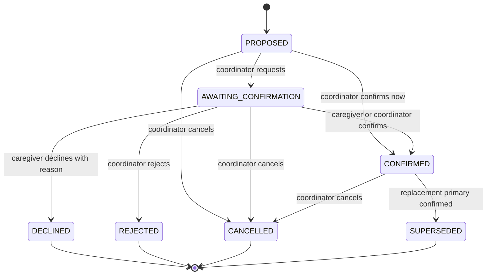

# CareCircle

A caregiver-aware care-continuity platform for families coordinating transport, medication help, appointments, and daily support. When a caregiver becomes unavailable or overloaded, care can break even when the medical plan has not changed. CareCircle is designed to deterministically surface operational care gaps, explain them clearly, suggest valid backups, and require human confirmation to resolve them.

**Team:** TODO: team name/members

**The caregiver is the second patient.**

## Quick start

Requirements: Docker Desktop with Compose and Python 3.11+ (3.12 recommended). From the repository root:

```powershell
Copy-Item .env.example .env # optional; scripts/start.ps1 creates it and generates SECRET_KEY
.\scripts\start.ps1
```

Or run `docker compose up --build -d` after creating `.env` from `.env.example`. The Compose app serves the API and bundled React UI from port 8000. Stop with `docker compose down` or `.\scripts\stop.ps1`. Demo accounts use `DEMO_PASSWORD` (default `Demo@1234`).

### Access URLs

- This laptop: [http://localhost:8000](http://localhost:8000)
- API docs: [http://localhost:8000/docs](http://localhost:8000/docs)
- Health: [http://localhost:8000/api/health](http://localhost:8000/api/health)
- Other LAN devices: run `python scripts/lan-info.py` and open the printed `http://<LAN-IP>:8000` URL. On Windows, run PowerShell as Administrator and use `.\scripts\open-firewall.ps1` if other devices cannot connect. The inbound rule covers Public as well as Private profiles because phone hotspots often appear as Public. All devices must share the laptop's Wi-Fi/hotspot; use the laptop's hotspot-facing address when it hosts the hotspot.

For emergency use without Docker, `.\scripts\run-local.ps1` builds the frontend and runs FastAPI with local SQLite. Docker + PostgreSQL is the supported deployment. Development: run backend Uvicorn on :8000, then `npm run dev` from `frontend/` (Vite :5173 proxies `/api`).

## Phase 1 — Foundation, Auth & LAN Deployment

### Built

- FastAPI backend with SQLAlchemy models and initial Alembic migration for users, patients, patient care teams, and audit history; PostgreSQL deployment and SQLite local/test path.
- Cookie-based JWT sessions, Argon2 passwords, family-only self-registration, role reload on each request, session versioning, logout and password change, CSRF header enforcement, and login throttling.
- Patient and care-team endpoints with membership authorization, coordinator restrictions, role compatibility checks, last-coordinator protection, and filtered clinical notes.
- Synthetic demo users (`users.is_synthetic`) and two synthetic patients (`patients.is_synthetic`) with shared househelp on both care teams. `DEMO_PASSWORD` can be changed from the default.
- Responsive family dashboard, role badge and demo sign-in chips, patient/care-team/history/system status loaded from the API, tokenized CSS, bundled Inter fonts, and operational disclaimer.
- Docker Compose on port 8000, LAN address helper, start/stop scripts, Windows firewall helper, no-Docker fallback, smoke script, project rules, and architecture/roadmap documentation.

### API endpoints

| Endpoint | Purpose |
|---|---|
| `GET /api/health` | API and database liveness |
| `GET /api/v1/meta` | Version, phase, demo mode, timezone, server time |
| `POST /api/v1/auth/register` | Create FAMILY account and sign in |
| `POST /api/v1/auth/login` | Sign in; rate limited |
| `POST /api/v1/auth/logout` | Clear session cookie |
| `GET /api/v1/auth/me` | Current DB-backed user |
| `POST /api/v1/auth/change-password` | Change password and invalidate prior sessions |
| `GET/POST /api/v1/patients` | List accessible patients / create patient |
| `GET/PATCH /api/v1/patients/{id}` | Read/update patient profile |
| `GET/POST /api/v1/patients/{id}/care-team` | List/add existing account to team |
| `DELETE /api/v1/patients/{id}/care-team/{member_id}` | Remove member subject to coordinator rule |
| `GET /api/v1/patients/{id}/history` | Paginated audit history |
| `POST /api/v1/admin/demo/reset` | Admin-only reset while demo mode is enabled |

All state-changing requests require `X-Requested-With: second-patient`. The browser API client sends it automatically. Unauthorized patient lookups return 403; unknown IDs return 404. Inputs reject unknown fields. Error responses use the common `error` envelope and request ID. The dashboard is live for family/admin demo accounts; remaining portal routes are marked for later phases.

### Audit notes

- ✅ **Repository and docs:** `.env` is ignored and not tracked; `.env.example` includes the settings declared in `Settings`; `.gitattributes` sets LF for shell scripts, Dockerfile, and entrypoint. Added `*.tsbuildinfo` and `.vite/` to ignore rules during this audit. The test-account table lists all eight seeded accounts and identifies the configured `DEMO_PASSWORD` as their password.
- ✅ **Security implementation review:** middleware enforces the CSRF header on state-changing methods and adds CSP/security headers; session cookies use HttpOnly and SameSite=Lax; unexpected errors return the common envelope without a stack trace. Runtime/browser-console confirmation is still needed.
- ✅ **Client URL review:** frontend API calls use relative paths and fonts are bundled locally; no CDN is configured in the app source.
- 🔧 **LAN guidance:** the address helper now lists candidate URLs, warns about networks outside known hotspot ranges, and optionally prints QR codes when `qrcode` is installed. Second-device access remains a manual network check.
- ⚠️ **Coverage and role landing:** the original 11-test suite did not cover every audit item (notably the complete permission matrix, all IDOR combinations, seed/reset edge cases, and forced-500 behavior). The role navigation is present for all eight seeded users in the frontend, but a browser-level redirect/nav check across every account has not been recorded. Run the checks in `Test Instructions` and inspect the browser console before claiming those items verified.
- ⚠️ **Clean-slate persistence:** perform `docker compose down -v`, rebuild/start, then restart and verify seed idempotency on a machine with Docker access. A real second-device LAN check is also required to verify the chosen network permits client-to-client traffic.

### Security and design decisions

- Demo accounts are isolated examples; newly registered users always receive FAMILY role. Roles are never accepted by the registration schema.
- Sessions live in an HttpOnly, SameSite=Lax cookie. `COOKIE_SECURE=false` supports plain HTTP LAN demos; use HTTPS and enable it when deployed behind TLS.
- User records are reloaded on each authenticated request; inactive accounts and changed token versions invalidate sessions.
- Patient data is scoped through care-team membership. Clinical notes are omitted for househelp. Audit history records patient/profile and team changes.
- The starting local database is SQLite; PostgreSQL 16 is the Compose path. An ordered idempotent seed registry holds phase data. `Base.metadata.create_all` is also kept available for test/local initialization; Alembic tracks schema revisions.
- Phase 1 has no AI features (`ai_enabled=false`). Decision engine, care-gap scoring, backup filtering, and confirmation workflow are later phases and will be deterministic backend code.

### Test and LAN verification

```powershell
python -m pytest backend/tests -q
python scripts/smoke.py --base-url http://localhost:8000
cd frontend; npm run lint; npm run typecheck; npm test; npm run build
```

For a second device, start the app, run `python scripts/lan-info.py`, ensure both devices share the same Wi-Fi/hotspot, run the Windows firewall helper if needed, then open the printed LAN URL in that device's browser. A second-device check requires a real second device and is not claimed as verified by repository tests.

## Architecture & Stack

See [docs/ARCHITECTURE.md](docs/ARCHITECTURE.md) for the full stack, security contracts, target domain, and phase roadmap. Phase 1 uses FastAPI, SQLAlchemy, Alembic, PostgreSQL 16 (SQLite for tests/local fallback), React 18, Vite, TypeScript, TanStack Query, and bundled Inter font assets.

## Supported Environments

Docker Compose on Windows, macOS, or Linux with Docker Desktop/Engine; same-network modern browsers including phones. Development requires Node 20 and Python 3.11+ (recommended 3.12). LAN use over plain HTTP is intended for trusted demo networks.

## Environment Variables

Copy `.env.example` to `.env`; `scripts/start.*` makes a local copy and generates a random secret if none exists.

| Variable | Default | Purpose |
|---|---|---|
| `APP_ENV` | `dev` | Runtime mode (`dev` / `prod`) |
| `SECRET_KEY` | safe placeholder | JWT signing key; change for production |
| `DATABASE_URL` | PostgreSQL Compose URL | SQLAlchemy database connection |
| `APP_TIMEZONE` | `Asia/Kolkata` | Display/application timezone |
| `DEMO_MODE` | `true` | Enables synthetic demo and guarded reset |
| `SEED_DEMO` | `true` | Seed demo accounts and patients at startup |
| `DEMO_PASSWORD` | `Demo@1234` | Password for every seeded account |
| `COOKIE_SECURE` | `false` | Set true when served over HTTPS |
| `SESSION_HOURS` | `12` | Session duration |
| `LOG_LEVEL` | `INFO` | Server logging level |
| `AI_PROVIDER` | `none` | Reserved for Phase 8 |
| `AI_API_KEY` | empty | Reserved for Phase 8; unused now |
| `AI_MODEL` | empty | Reserved for Phase 8; unused now |
| `GIT_SHA` | `dev` | Build identifier surfaced in metadata |

## Database Setup

Compose starts PostgreSQL 16 with a named `pgdata` volume. The database port is bound to `127.0.0.1`; the web app is exposed on all host interfaces at 8000. Alembic runs on container start. `docker compose down` retains data; `docker compose down -v` deletes the database volume. The local fallback uses `./second_patient.db` SQLite.

## Test Instructions

Backend: `python -m pytest backend/tests -q` (set `PYTHONPATH=backend` if your pytest environment does not read `backend/pyproject.toml`). Frontend: run `npm ci`/`npm install`, then `npm run lint`, `npm run typecheck`, `npm test`, `npm run build` from `frontend/`. Deployment smoke: `python scripts/smoke.py --base-url http://localhost:8000`; run the same command with the server laptop LAN URL for network verification. Smoke creates a random test account and patient.

## Test Accounts

All accounts below are synthetic; all use the configured `DEMO_PASSWORD`.

| Role | Email |
|---|---|
| ADMIN | `admin@secondpatient.demo` |
| FAMILY coordinator | `anita.iyer@secondpatient.demo` |
| FAMILY member | `karthik.iyer@secondpatient.demo` |
| FAMILY coordinator | `meera.pai@secondpatient.demo` |
| PATIENT | `ramesh.iyer@secondpatient.demo` |
| HOUSEHELP | `savitha@secondpatient.demo` |
| NURSE | `divya.menon@secondpatient.demo` |
| DOCTOR | `dr.arjun.nair@secondpatient.demo` |

## AI Tools Disclosure

Codex was used for code generation and planning. Update this disclosure if Cursor or Claude is used later.

## Third-Party Resources & Licenses

React and React DOM (MIT), Vite (MIT), TypeScript (Apache-2.0), React Router (MIT), TanStack Query (MIT), Lucide (ISC), Inter fonts from @fontsource (SIL Open Font License 1.1), FastAPI (MIT), SQLAlchemy (MIT), Alembic (MIT), Pydantic (MIT), Argon2 bindings (MIT), PyJWT (MIT), psycopg (LGPL-3.0-or-later). PostgreSQL uses the PostgreSQL License; container images retain their upstream licenses. No external CDN assets are loaded. See package metadata and upstream license files for complete terms.

## Synthetic Data Disclosure

All supplied people, care notes, and clinical-looking notes are fictional demonstration data, not real patient records. Seeded user and patient rows set `is_synthetic=true`; self-registered accounts are not marked synthetic. Do not enter real health or identifying data into this demo.

## Known Limitations

Phase 1 provides account and patient/team foundation only. The reset route clears patient/team/history rows but preserves user accounts. Remaining role portals are placeholders, and no gap detection, activity assignments, recommendations, notifications, AI, or real-time updates exist yet. Demo role switching uses pre-seeded accounts. The second-device LAN check is manual; host firewall rules and Wi-Fi client isolation can still prevent access. Login throttling is process-local and resets on restart. Database schema creation includes a create-all safety path alongside the migration baseline. npm audit reports build-only transitive advisories from the requested Tailwind CSS 3.4 toolchain; frontend dependencies are not copied into the runtime image.

---

## Existing Repository Event Guidelines

### Branch Rules
- Each team maintains `main`, `bugbounty`, and `fixing` branches. `main` is ongoing development; `bugbounty` is deployment/peer-testing; `fixing` is bug fixes.
- Keep `main` and `bugbounty` in sync until the Attack Phase. Never delete `bugbounty` or `fixing`.

### Attack Phase
- `bugbounty` freezes at the start of the Attack Phase. Only `bugbounty` is deployed for peer testing. Development may continue on `main`.
- Test only assigned projects and follow event testing rules.

### Fixing Phase
- Create `fixing` directly from `bugbounty` at the beginning of Fixing. Commit fixes only there; keep `bugbounty` frozen.
- Stop fixing commits at 3:30 AM. Merge validated fixes into `main` only after the phase ends. Update `bugbounty` only after organizers announce evaluation is complete.

### Bug Reporting and Safety
- Maximum 10 bug reports overall and 4 per target team. Report critical vulnerabilities or exposed data privately to organizers.
- Do not modify frozen branches, bypass repository restrictions, or perform destructive testing, denial of service, phishing, malware deployment, or tests against unrelated systems.

## Phase 2 — Core Domain: Patients, Caregivers, Availability, Activities, Assignments

Phase 2 expands the patient foundation into a care network and a scheduled plan. Caregivers are separate from login accounts; a caregiver may optionally link to a login and may be shared across patients. The API is the source of truth for permissions, assignments, and warning results. Phase 2 does not detect care gaps or calculate safety/medical risk.

### API added in Phase 2

All routes require authentication. Mutations also require `X-Requested-With: second-patient`. Inputs reject unknown fields where model schemas are used. This adds 32 route operations, including the five assignment transition routes.

| Area | Endpoints | Purpose |
|---|---|---|
| Patients | `GET/PATCH /api/v1/patients/{id}`; `PUT /patients/{id}/support-needs`; `GET /patients/{id}/overview` | Profile fields, support-needs replace-all, next-week summary and recent history |
| Care network | `GET/POST /patients/{id}/caregivers`; `POST/DELETE /patients/{id}/caregivers/{caregiver_id}/link`; `GET/PATCH /caregivers/{id}` | Add, link, inspect, update, and unlink caregivers |
| Availability | `GET/PUT /caregivers/{id}/schedule`; `GET /caregivers/{id}/availability?from&to`; `POST /caregivers/{id}/availability-overrides`; `POST /caregivers/{id}/availability-overrides/{override_id}/cancel` | Weekly windows, effective availability, and cancellable overrides (maximum 90-day query range) |
| Workload | `GET /patients/{id}/caregivers/workload?from&to`; `GET /caregivers/{id}/assignment-history` | Workload by local day/week and caregiver assignment history, with other-patient details masked |
| Activities | `GET/POST /patients/{id}/activities`; `POST /patients/{id}/activities/series`; `GET/PATCH /activities/{id}`; `POST /activities/{id}/cancel|complete`; `POST/DELETE /activities/{id}/dependencies` | List, create, edit, recur, complete/cancel, and connect activities |
| Assignments | `POST /activities/{id}/assignments`; `POST /assignments/{id}/request-confirmation|confirm|decline|reject|cancel` | Assign primary/backup caregivers and move assignment state |

Patient and activity responses include `my_permissions` for UI gating. The patient profile, care network, care plan, and history routes have working Phase 2 screens. Care plan actions display returned warnings. Other role pages remain planned. Time labels and datetime entry use `Asia/Kolkata` independent of the device timezone.

### Availability, overlap, and workload

Weekly schedule windows describe when a caregiver is available. No rows means unavailable. Each row uses a weekday (`0` Monday through `6` Sunday), start minute, and end minute after local midnight. Adjacent intervals merge; overlapping or duplicate rows are rejected by the schedule API. A required activity window includes its before/after buffers and must fit entirely inside effective availability.

An active `UNAVAILABLE` override removes time even when a baseline or `AVAILABLE` override covers it. An active `AVAILABLE` override can add time outside the baseline. Cancelling an override sets `cancelled_at`; the row remains for history. Availability calculations handle midnight and multi-day intervals. `engine/availability.py` returns uncovered portions and the blocking overrides for later explanations.

Overlap uses buffered time windows; intervals that only touch do not overlap. Workload counts primary assignments by the activity's local start date and Monday–Sunday week. Confirmed and pending work are separate. Backup assignments are standby and do not count. Shared-caregiver computations include all patients, but summaries never expose other patients' names or activity titles.

### Assignment state machine



Only one active primary assignment is allowed per activity. A confirm submitted after the state has changed returns `409` consistently. Terminal states cannot change.

### Permission matrix

| Role | Patient plan | Manage plan/network | Own availability and assignment response | Clinical notes |
|---|---|---|---|---|
| Coordinator | Read | Full, for coordinated patients | Yes | Read |
| Family member | Read shared plan | No | Own caregiver only | Read shared notes |
| Househelp / nurse | Own assigned activities | No | Own caregiver/assignment only | No (househelp); nurse can read |
| Patient | Read-only | No | No | Own patient notes |
| Doctor | Read plan/appointments | No | No | Read |
| Admin | All patients | Full | Full | Read |

Caregiver phone numbers are limited to admins, coordinators of linked patients, and that caregiver's own linked login. API permission checks remain authoritative even when a UI control is hidden.

### Blocks and warnings

| Hard block (`4xx`) | Warning returned with success |
|---|---|
| Invalid or backwards time, naive datetime, unknown support code, caregiver not linked/active, assignment on completed/cancelled activity, second active primary, cross-patient or cyclic dependency | Missing caregiver capability, incomplete availability, overlapping caregiver commitment, daily/weekly workload limit, patient activity overlap, deadline less than 24 hours away |

Warnings include a stable `code`, a plain-language `message`, and structured `details`. Phase 3 can reuse the availability and workload calculations to explain care gaps.

### Synthetic walkthrough

The demo seed is relative to the current clock. Anita coordinates Ramesh's plan and is available around the clock. Karthik has a next-day work override from 12:30 to 14:00; Suresh is available mornings. Savitha is shared by Ramesh and Sharada and has daily assistance, medication, mobility, and pickup capabilities but no transport capability. Divya is the nurse backup. The plan includes a cardiology visit and transport, a prescription pickup, a seven-day medication series, a lab trip, post-appointment assistance, and an intentionally unassigned supplies pickup. Sharada has assistance/meal preparation with Savitha and a doctor visit with Meera. Every seeded person and activity is fictional and marked synthetic. No disruption is seeded; the Phase 3/4 demo will add one.

To explore: sign in as `anita.iyer@secondpatient.demo`, open **Patient Profile**, **Care Network**, **Care Plan**, and **History**. The shared demo password is the configured `DEMO_PASSWORD` (default `Demo@1234`). Availability changes and assignments appear in History. Assigning a caregiver without a matching capability is allowed and returns a warning.

### Phase 2 checks and known limitations

```powershell
python -m pytest backend/tests -q
cd frontend; npm run lint; npm run typecheck; npm test; npm run build
cd ..; python scripts/smoke.py --base-url http://localhost:8000
```

The reassessment hook records calls but is deliberately a no-op; care gaps, risk scoring, recommendations, and resolution remain later phases. The web UI provides basic profile, care-network, plan, and history actions; full edit drawers, series controls, caregiver-link management, conflict detail UI, and all role-specific portals are not complete. The smoke script uses a freshly registered user's own patient. A second-device LAN check remains manual and requires a network that permits client-to-client connections.
