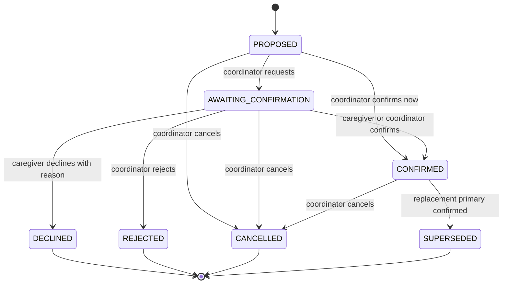

# CareCircle

A caregiver-aware care-continuity platform for families coordinating transport, medication help, appointments, and daily support. When a caregiver becomes unavailable or overloaded, care can break even when the medical plan has not changed. CareCircle is designed to deterministically surface operational care gaps, explain them clearly, suggest valid backups, and require human confirmation to resolve them.

**Team:** TODO: team name/members

**The caregiver is the second patient.**

## Quick start

Requirements: Docker Desktop with Compose and Python 3.11+ (3.12 recommended). From the repository root:

```powershell
Copy-Item .env.example .env # optional; scripts/start.ps1 creates it and generates SECRET_KEY
.\scripts\start.ps1
```

Or run `docker compose up --build -d` after creating `.env` from `.env.example`. The Compose app serves the API and bundled React UI from port 8000. Stop with `docker compose down` or `.\scripts\stop.ps1`. Demo accounts use `DEMO_PASSWORD` (default `Demo@1234`).

### Access URLs

- This laptop: [http://localhost:8000](http://localhost:8000)
- API docs: [http://localhost:8000/docs](http://localhost:8000/docs)
- Health: [http://localhost:8000/api/health](http://localhost:8000/api/health)
- Other LAN devices: run `python scripts/lan-info.py` and open the printed current Wi-Fi `http://<LAN-IP>:8000` URL. The address can change when Wi-Fi or hotspot reconnects. If the Windows firewall rule is missing, open PowerShell as Administrator, go to this project, and run `.\scripts\open-firewall.ps1` once. It allows inbound TCP 8000 only from the local subnet, including when a phone hotspot is classified as Public. Both devices must share the same Wi-Fi/hotspot. Networks with client isolation can still block device-to-device connections.

For emergency use without Docker, `.\scripts\run-local.ps1` builds the frontend and runs FastAPI with local SQLite. Docker + PostgreSQL is the supported deployment. Development: run backend Uvicorn on :8000, then `npm run dev` from `frontend/` (Vite :5173 proxies `/api`).

## Phase 1 — Foundation, Auth & LAN Deployment

### Built

- FastAPI backend with SQLAlchemy models and initial Alembic migration for users, patients, patient care teams, and audit history; PostgreSQL deployment and SQLite local/test path.
- Cookie-based JWT sessions, Argon2 passwords, family-only self-registration, role reload on each request, session versioning, logout and password change, CSRF header enforcement, and login throttling.
- Patient and care-team endpoints with membership authorization, coordinator restrictions, role compatibility checks, last-coordinator protection, and filtered clinical notes.
- Synthetic demo users (`users.is_synthetic`) and two synthetic patients (`patients.is_synthetic`) with shared househelp on both care teams. `DEMO_PASSWORD` can be changed from the default.
- Responsive family dashboard, role badge and demo sign-in chips, patient/care-team/history/system status loaded from the API, tokenized CSS, bundled Inter fonts, and operational disclaimer.
- Docker Compose on port 8000, LAN address helper, start/stop scripts, Windows firewall helper, no-Docker fallback, smoke script, project rules, and architecture/roadmap documentation.

### API endpoints

| Endpoint | Purpose |
|---|---|
| `GET /api/health` | API and database liveness |
| `GET /api/v1/meta` | Version, phase, demo mode, timezone, server time |
| `POST /api/v1/auth/register` | Create FAMILY account and sign in |
| `POST /api/v1/auth/login` | Sign in; rate limited |
| `POST /api/v1/auth/logout` | Clear session cookie |
| `GET /api/v1/auth/me` | Current DB-backed user |
| `POST /api/v1/auth/change-password` | Change password and invalidate prior sessions |
| `GET/POST /api/v1/patients` | List accessible patients / create patient |
| `GET/PATCH /api/v1/patients/{id}` | Read/update patient profile |
| `GET/POST /api/v1/patients/{id}/care-team` | List/add existing account to team |
| `DELETE /api/v1/patients/{id}/care-team/{member_id}` | Remove member subject to coordinator rule |
| `GET /api/v1/patients/{id}/history` | Paginated audit history |
| `POST /api/v1/admin/demo/reset` | Admin-only reset while demo mode is enabled |

All state-changing requests require `X-Requested-With: second-patient`. The browser API client sends it automatically. Unauthorized patient lookups return 403; unknown IDs return 404. Inputs reject unknown fields. Error responses use the common `error` envelope and request ID. The dashboard is live for family/admin demo accounts; remaining portal routes are marked for later phases.

### Audit notes

- ✅ **Repository and docs:** `.env` is ignored and not tracked; `.env.example` includes the settings declared in `Settings`; `.gitattributes` sets LF for shell scripts, Dockerfile, and entrypoint. Added `*.tsbuildinfo` and `.vite/` to ignore rules during this audit. The test-account table lists all eight seeded accounts and identifies the configured `DEMO_PASSWORD` as their password.
- ✅ **Security implementation review:** middleware enforces the CSRF header on state-changing methods and adds CSP/security headers; session cookies use HttpOnly and SameSite=Lax; unexpected errors return the common envelope without a stack trace. Runtime/browser-console confirmation is still needed.
- ✅ **Client URL review:** frontend API calls use relative paths and fonts are bundled locally; no CDN is configured in the app source.
- 🔧 **LAN guidance:** the address helper now lists candidate URLs, warns about networks outside known hotspot ranges, and optionally prints QR codes when `qrcode` is installed. Second-device access remains a manual network check.
- ⚠️ **Coverage and role landing:** the original 11-test suite did not cover every audit item (notably the complete permission matrix, all IDOR combinations, seed/reset edge cases, and forced-500 behavior). The role navigation is present for all eight seeded users in the frontend, but a browser-level redirect/nav check across every account has not been recorded. Run the checks in `Test Instructions` and inspect the browser console before claiming those items verified.
- ⚠️ **Clean-slate persistence:** perform `docker compose down -v`, rebuild/start, then restart and verify seed idempotency on a machine with Docker access. A real second-device LAN check is also required to verify the chosen network permits client-to-client traffic.

### Security and design decisions

- Demo accounts are isolated examples; newly registered users always receive FAMILY role. Roles are never accepted by the registration schema.
- Sessions live in an HttpOnly, SameSite=Lax cookie. `COOKIE_SECURE=false` supports plain HTTP LAN demos; use HTTPS and enable it when deployed behind TLS.
- User records are reloaded on each authenticated request; inactive accounts and changed token versions invalidate sessions.
- Patient data is scoped through care-team membership. Clinical notes are omitted for househelp. Audit history records patient/profile and team changes.
- The starting local database is SQLite; PostgreSQL 16 is the Compose path. An ordered idempotent seed registry holds phase data. `Base.metadata.create_all` is also kept available for test/local initialization; Alembic tracks schema revisions.
- Phase 1 has no AI features (`ai_enabled=false`). Decision engine, care-gap scoring, backup filtering, and confirmation workflow are later phases and will be deterministic backend code.

### Test and LAN verification

```powershell
python -m pytest backend/tests -q
python scripts/smoke.py --base-url http://localhost:8000
cd frontend; npm run lint; npm run typecheck; npm test; npm run build
```

For a second device, start the app, run `python scripts/lan-info.py`, ensure both devices share the same Wi-Fi/hotspot, run the Windows firewall helper if needed, then open the printed LAN URL in that device's browser. A second-device check requires a real second device and is not claimed as verified by repository tests.

## Architecture & Stack

See [docs/ARCHITECTURE.md](docs/ARCHITECTURE.md) for the full stack, security contracts, target domain, and phase roadmap. Phase 1 uses FastAPI, SQLAlchemy, Alembic, PostgreSQL 16 (SQLite for tests/local fallback), React 18, Vite, TypeScript, TanStack Query, and bundled Inter font assets.

## Supported Environments

Docker Compose on Windows, macOS, or Linux with Docker Desktop/Engine; same-network modern browsers including phones. Development requires Node 20 and Python 3.11+ (recommended 3.12). LAN use over plain HTTP is intended for trusted demo networks.

## Environment Variables

Copy `.env.example` to `.env`; `scripts/start.*` makes a local copy and generates a random secret if none exists.

| Variable | Default | Purpose |
|---|---|---|
| `APP_ENV` | `dev` | Runtime mode (`dev` / `prod`) |
| `SECRET_KEY` | safe placeholder | JWT signing key; change for production |
| `DATABASE_URL` | PostgreSQL Compose URL | SQLAlchemy database connection |
| `APP_TIMEZONE` | `Asia/Kolkata` | Display/application timezone |
| `DEMO_MODE` | `true` | Enables synthetic demo and guarded reset |
| `SEED_DEMO` | `true` | Seed demo accounts and patients at startup |
| `DEMO_PASSWORD` | `Demo@1234` | Password for every seeded account |
| `ESCALATION_TIME_SCALE` | `1.0` | Timer scale in demo mode only; `0.1` shortens minute timers to seconds |
| `COOKIE_SECURE` | `false` | Set true when served over HTTPS |
| `SESSION_HOURS` | `12` | Session duration |
| `LOG_LEVEL` | `INFO` | Server logging level |
| `AI_PROVIDER` | `none` | Reserved for Phase 8 |
| `AI_API_KEY` | empty | Reserved for Phase 8; unused now |
| `AI_MODEL` | empty | Reserved for Phase 8; unused now |
| `GIT_SHA` | `dev` | Build identifier surfaced in metadata |

## Database Setup

Compose starts PostgreSQL 16 with a named `pgdata` volume. The database port is bound to `127.0.0.1`; the web app is exposed on all host interfaces at 8000. Alembic runs on container start. `docker compose down` retains data; `docker compose down -v` deletes the database volume. The local fallback uses `./second_patient.db` SQLite.

## Test Instructions

Backend: `python -m pytest backend/tests -q` (set `PYTHONPATH=backend` if your pytest environment does not read `backend/pyproject.toml`). Frontend: run `npm ci`/`npm install`, then `npm run lint`, `npm run typecheck`, `npm test`, `npm run build` from `frontend/`. Deployment smoke: `python scripts/smoke.py --base-url http://localhost:8000`; run the same command with the server laptop LAN URL for network verification. Smoke creates a random test account and patient.

## Test Accounts

All accounts below are synthetic; all use the configured `DEMO_PASSWORD`.

| Role | Email |
|---|---|
| ADMIN | `admin@secondpatient.demo` |
| FAMILY coordinator | `anita.iyer@secondpatient.demo` |
| FAMILY member | `karthik.iyer@secondpatient.demo` |
| FAMILY coordinator | `meera.pai@secondpatient.demo` |
| PATIENT | `ramesh.iyer@secondpatient.demo` |
| HOUSEHELP | `savitha@secondpatient.demo` |
| NURSE | `divya.menon@secondpatient.demo` |
| DOCTOR | `dr.arjun.nair@secondpatient.demo` |

## AI Tools Disclosure

Codex was used for code generation and planning. Update this disclosure if Cursor or Claude is used later.

## Third-Party Resources & Licenses

React and React DOM (MIT), Vite (MIT), TypeScript (Apache-2.0), React Router (MIT), TanStack Query (MIT), Lucide (ISC), Inter fonts from @fontsource (SIL Open Font License 1.1), FastAPI (MIT), SQLAlchemy (MIT), Alembic (MIT), Pydantic (MIT), Argon2 bindings (MIT), PyJWT (MIT), psycopg (LGPL-3.0-or-later). PostgreSQL uses the PostgreSQL License; container images retain their upstream licenses. No external CDN assets are loaded. See package metadata and upstream license files for complete terms.

## Synthetic Data Disclosure

All supplied people, care notes, and clinical-looking notes are fictional demonstration data, not real patient records. Seeded user and patient rows set `is_synthetic=true`; self-registered accounts are not marked synthetic. Do not enter real health or identifying data into this demo.

## Known Limitations

CareCircle currently provides the Phase 1/2 foundation and an initial Phase 3 deterministic classifier/message-to-incident path. Time-boxed escalation, complete role portals, absence simulation, and real-time updates are not yet implemented. The reset route clears patient/team/history rows but preserves user accounts. Demo role switching uses pre-seeded accounts. The second-device LAN check is manual; host firewall rules and Wi-Fi client isolation can still prevent access. Login throttling is process-local and resets on restart. Database schema creation includes a create-all safety path alongside the migration baseline. npm audit reports build-only transitive advisories from the requested Tailwind CSS 3.4 toolchain; frontend dependencies are not copied into the runtime image.

---

## Existing Repository Event Guidelines

### Branch Rules
- Each team maintains `main`, `bugbounty`, and `fixing` branches. `main` is ongoing development; `bugbounty` is deployment/peer-testing; `fixing` is bug fixes.
- Keep `main` and `bugbounty` in sync until the Attack Phase. Never delete `bugbounty` or `fixing`.

### Attack Phase
- `bugbounty` freezes at the start of the Attack Phase. Only `bugbounty` is deployed for peer testing. Development may continue on `main`.
- Test only assigned projects and follow event testing rules.

### Fixing Phase
- Create `fixing` directly from `bugbounty` at the beginning of Fixing. Commit fixes only there; keep `bugbounty` frozen.
- Stop fixing commits at 3:30 AM. Merge validated fixes into `main` only after the phase ends. Update `bugbounty` only after organizers announce evaluation is complete.

### Bug Reporting and Safety
- Maximum 10 bug reports overall and 4 per target team. Report critical vulnerabilities or exposed data privately to organizers.
- Do not modify frozen branches, bypass repository restrictions, or perform destructive testing, denial of service, phishing, malware deployment, or tests against unrelated systems.

## Phase 2 — Core Domain: Patients, Caregivers, Availability, Activities, Assignments

Phase 2 expands the patient foundation into a care network and a scheduled plan. Caregivers are separate from login accounts; a caregiver may optionally link to a login and may be shared across patients. The API is the source of truth for permissions, assignments, and warning results. Phase 2 does not detect care gaps or calculate safety/medical risk.

### API added in Phase 2

All routes require authentication. Mutations also require `X-Requested-With: second-patient`. Inputs reject unknown fields where model schemas are used. This adds 32 route operations, including the five assignment transition routes.

| Area | Endpoints | Purpose |
|---|---|---|
| Patients | `GET/PATCH /api/v1/patients/{id}`; `PUT /patients/{id}/support-needs`; `GET /patients/{id}/overview` | Profile fields, support-needs replace-all, next-week summary and recent history |
| Care network | `GET/POST /patients/{id}/caregivers`; `POST/DELETE /patients/{id}/caregivers/{caregiver_id}/link`; `GET/PATCH /caregivers/{id}` | Add, link, inspect, update, and unlink caregivers |
| Availability | `GET/PUT /caregivers/{id}/schedule`; `GET /caregivers/{id}/availability?from&to`; `POST /caregivers/{id}/availability-overrides`; `POST /caregivers/{id}/availability-overrides/{override_id}/cancel` | Weekly windows, effective availability, and cancellable overrides (maximum 90-day query range) |
| Workload | `GET /patients/{id}/caregivers/workload?from&to`; `GET /caregivers/{id}/assignment-history` | Workload by local day/week and caregiver assignment history, with other-patient details masked |
| Activities | `GET/POST /patients/{id}/activities`; `POST /patients/{id}/activities/series`; `GET/PATCH /activities/{id}`; `POST /activities/{id}/cancel|complete`; `POST/DELETE /activities/{id}/dependencies` | List, create, edit, recur, complete/cancel, and connect activities |
| Assignments | `POST /activities/{id}/assignments`; `POST /assignments/{id}/request-confirmation|confirm|decline|reject|cancel` | Assign primary/backup caregivers and move assignment state |

Patient and activity responses include `my_permissions` for UI gating. The patient profile, care network, care plan, and history routes have working Phase 2 screens. Care plan actions display returned warnings. Other role pages remain planned. Time labels and datetime entry use `Asia/Kolkata` independent of the device timezone.

### Availability, overlap, and workload

Weekly schedule windows describe when a caregiver is available. No rows means unavailable. Each row uses a weekday (`0` Monday through `6` Sunday), start minute, and end minute after local midnight. Adjacent intervals merge; overlapping or duplicate rows are rejected by the schedule API. A required activity window includes its before/after buffers and must fit entirely inside effective availability.

An active `UNAVAILABLE` override removes time even when a baseline or `AVAILABLE` override covers it. An active `AVAILABLE` override can add time outside the baseline. Cancelling an override sets `cancelled_at`; the row remains for history. Availability calculations handle midnight and multi-day intervals. `engine/availability.py` returns uncovered portions and the blocking overrides for later explanations.

Overlap uses buffered time windows; intervals that only touch do not overlap. Workload counts primary assignments by the activity's local start date and Monday–Sunday week. Confirmed and pending work are separate. Backup assignments are standby and do not count. Shared-caregiver computations include all patients, but summaries never expose other patients' names or activity titles.

### Assignment state machine



Only one active primary assignment is allowed per activity. A confirm submitted after the state has changed returns `409` consistently. Terminal states cannot change.

### Permission matrix

| Role | Patient plan | Manage plan/network | Own availability and assignment response | Clinical notes |
|---|---|---|---|---|
| Coordinator | Read | Full, for coordinated patients | Yes | Read |
| Family member | Read shared plan | No | Own caregiver only | Read shared notes |
| Househelp / nurse | Own assigned activities | No | Own caregiver/assignment only | No (househelp); nurse can read |
| Patient | Read-only | No | No | Own patient notes |
| Doctor | Read plan/appointments | No | No | Read |
| Admin | All patients | Full | Full | Read |

Caregiver phone numbers are limited to admins, coordinators of linked patients, and that caregiver's own linked login. API permission checks remain authoritative even when a UI control is hidden.

### Blocks and warnings

| Hard block (`4xx`) | Warning returned with success |
|---|---|
| Invalid or backwards time, naive datetime, unknown support code, caregiver not linked/active, assignment on completed/cancelled activity, second active primary, cross-patient or cyclic dependency | Missing caregiver capability, incomplete availability, overlapping caregiver commitment, daily/weekly workload limit, patient activity overlap, deadline less than 24 hours away |

Warnings include a stable `code`, a plain-language `message`, and structured `details`. Phase 3 can reuse the availability and workload calculations to explain care gaps.

### Synthetic walkthrough

The demo seed is relative to the current clock. Anita coordinates Ramesh's plan and is available around the clock. Karthik has a next-day work override from 12:30 to 14:00; Suresh is available mornings. Savitha is shared by Ramesh and Sharada and has daily assistance, medication, mobility, and pickup capabilities but no transport capability. Divya is the nurse backup. The plan includes a cardiology visit and transport, a prescription pickup, a seven-day medication series, a lab trip, post-appointment assistance, and an intentionally unassigned supplies pickup. Sharada has assistance/meal preparation with Savitha and a doctor visit with Meera. Every seeded person and activity is fictional and marked synthetic. No disruption is seeded; the Phase 3/4 demo will add one.

To explore: sign in as `anita.iyer@secondpatient.demo`, open **Patient Profile**, **Care Network**, **Care Plan**, and **History**. The shared demo password is the configured `DEMO_PASSWORD` (default `Demo@1234`). Availability changes and assignments appear in History. Assigning a caregiver without a matching capability is allowed and returns a warning.

### Phase 2 checks and known limitations

```powershell
python -m pytest backend/tests -q
cd frontend; npm run lint; npm run typecheck; npm test; npm run build
cd ..; python scripts/smoke.py --base-url http://localhost:8000
```

The reassessment hook records calls but is deliberately a no-op; care gaps, risk scoring, recommendations, and resolution remain later phases. The web UI provides basic profile, care-network, plan, and history actions; full edit drawers, series controls, caregiver-link management, conflict detail UI, and all role-specific portals are not complete. The smoke script uses a freshly registered user's own patient. A second-device LAN check remains manual and requires a network that permits client-to-client connections.

## Phase 3 — Escalation Engine & Patient Messaging

CareCircle branding, role display labels, revised product direction, and the Phase 3 metadata are now live. The deterministic classifier is a pure backend module with English, Hindi, Kannada, and Telugu phrase coverage, explicit L0–L5 routing levels, safety modifiers, SOS override, unknown-text fallback to L2, and a raise-only advisor interface. Its table-driven test covers 84 classifier examples across the supported languages and scripts. Alembic adds patient messages, incidents, incident events, and notifications. Authenticated patient/care-team APIs accept messages and SOS reports, save a safe summary, create role-routed in-app notifications, and expose incident summaries, acknowledgement, resolution, and a user's notification list. Message text is omitted from audit history and notification content.

A single-worker, 15-second backend tick advances due incidents using persisted acknowledgement and resolution deadlines, severity multipliers, category caps, a configurable quiet-hours policy, and a demo-only time scale. Role-filtered incident summaries, acknowledgement, manual raise/lower with reasons, policy read/update/reset APIs, scheduled-activity acknowledgement/overdue detection, and a task-ack endpoint are included. The patient Help page has quick replies, text entry, a cancellable SOS countdown, status polling, and 108/112 links; the Incident Center has role-filtered lists, one-tap acknowledgement, escalation deadline display, and an unacknowledged emergency banner. The notification bell, policy editor, and admin speed/scenario panel are also implemented. Remaining work includes backup offers and decision cards, nurse visit and doctor instruction flows, doctor summary, SSE, digest generation, offline queue, multilingual UI, full-screen alert/audio experience, detailed incident action cards, and the complete clinical role portal workflows. See [docs/ESCALATION.md](docs/ESCALATION.md) for implemented behavior and limits. Lexicons are machine-drafted and require native-speaker review before real use.

### Available endpoints

| Endpoint | Purpose |
|---|---|
| `POST /api/v1/patients/{id}/messages` | Submit a patient message (`Idempotency-Key` supported) and create a routed incident |
| `POST /api/v1/patients/{id}/sos` | Create an L5 SOS incident |
| `GET /api/v1/incidents?patient_id=...&status=OPEN` | List patient-safe incident summaries for accessible care teams |
| `GET /api/v1/incidents/{id}` | Read an authorised incident and timeline (patient timelines are redacted) |
| `POST /api/v1/incidents/{id}/acknowledge` | Claim an open incident |
| `POST /api/v1/incidents/{id}/escalate` | Human raises the routing level with a reason |
| `POST /api/v1/incidents/{id}/lower` | Permitted primary contact or care professional lowers the level with a reason and audit entry |
| `POST /api/v1/incidents/{id}/resolve` | Resolve with a code; L5 requires acknowledgement and a note |
| `GET /api/v1/notifications?unread=true` | List the signed-in user's in-app notifications |
| `POST /api/v1/notifications/{id}/read` | Mark an owned notification read |
| `GET/PUT /api/v1/patients/{id}/escalation-policy` | Read or update role-authorized per-patient timer and quiet-hour settings |
| `POST /api/v1/patients/{id}/escalation-policy/reset` | Restore the system policy |
| `POST /api/v1/activities/{id}/acknowledge` | Acknowledge an assigned primary caregiver activity |
| `POST /api/v1/admin/demo/escalation-speed` | Set the demo-only timer scale |
| `POST /api/v1/admin/demo/scenarios/{name}` | Run or reset a synthetic escalation scenario |
| `GET /api/v1/meta` | Reports CareCircle and phase 3 |

All mutation routes require authentication and the existing CSRF header. The required success path to try is sign in as the synthetic patient, POST “I need water”, then inspect the incident as a care-team account, acknowledge, and resolve. Repeat with `/sos` to confirm L5 creation. Demo accounts are listed above; use the configured `DEMO_PASSWORD`.

### Phase 3 test instructions and verification

Run the backend and frontend commands in [Test Instructions](#test-instructions), then run the smoke script against localhost and the host LAN address. The Phase 3 smoke extension is in `scripts/smoke.py`. The earlier verification record below was current at Phase 3; the Phase 4 run is recorded in the Phase 4 section. A real second-device check remains manual. Manual emergency demo: submit a chest-pain message or SOS and confirm the L5 record and notification; use phone emergency services directly for any real emergency.

### Manual escalation demo

1. Sign in as Anita and open **Escalation Policy** for Ramesh. Set L1 and L2 acknowledgement timers to 1 minute, then save.
2. Sign in as Admin and set the demo timer scale to `0.1` in **Admin demo panel**. Keep Anita and Savitha open in separate browser sessions.
3. Run `daily_help`, or sign in as Ramesh in another session and send “I need water”. Confirm the request appears as L1 for Savitha (or L2 if no caretaker login is available). Leave it unacknowledged and watch the Incident Center advance to L2 and then L3.
4. Run the `sos` scenario and confirm the L5 banner and 108/112 links. This is an in-app demonstration only; it does not contact emergency services.

Preflight on 2026-10-14 found the local shell did not have a `python` alias or host pytest, and the frontend dependency tree was initially absent. Docker Compose was initially unavailable because the ignored `.env` file was absent. A later Docker run passed 146 backend tests and 32 smoke checks; the frontend suite passed 5 tests. These were the Phase 3 baseline results, not Phase 4 verification. Create `.env` from `.env.example` before starting Compose.

## Phase 3 decisions

- Unknown or ambiguous text routes to L2 `UNCLASSIFIED`; only explicit positive patterns may route to L0.
- The SOS shortcut overrides message classification to L5. The patient Help page includes a three-second cancellable countdown and direct `tel:108` / `tel:112` links.
- Initial routing uses care-team roles; a 15-second single-worker service applies persisted deadlines and records each transition. There is no SMS or phone integration.
- Safe summaries are deterministic from patient name, message category, and time. Raw message text stays in the message table and is omitted from audit and notification payloads.
- Role labels are display-only; stored enum values, package names, database names, environment names, and demo emails remain stable.

## Phase 4 — Caregiver Command Center

### Starting point inventory

- `/api/v1/meta` reported Phase 3, version 0.3.0. Git history included the Phase 1 foundation, Phase 2 care domain, Phase 3 message/escalation work, and later authentication and LAN fixes. The working tree was clean at preflight.
- README contained cumulative Phase 1–3 sections. Existing models and migrations covered users, patients, care-team memberships, activities, caregivers, schedules, overrides, assignments, incidents, messages, notifications, and escalation timers; migrations ended at `0005_escalation_timers.py`.
- Pure `engine/availability.py` and `engine/workload.py`, classifier/escalation engines, and the Phase 2 `services/reassess.py` hook existed. The 15-second single-worker scheduler existed. There was no SSE stream, frontend i18n dictionary, or existing Command Center.
- Phase 4 adds `0006_command_center.py`, deterministic attention and daily-plan modules, action-item reconciliation, template briefs, role-scoped APIs, and a polling UI. The existing incident and notification models are reused; no parallel incident system was added.
- Baseline frontend checks passed. The Phase 4 initial Docker/smoke baseline could not be started from this environment because the Docker socket was denied in the sandbox and the requested elevated invocation was rejected. Phase 4 final test and Docker results are recorded after implementation below.

### What changed

The Command Center is the landing page for primary contacts and administrators; househelp and nurses receive the same route as a reduced My Day. It leads with needs-now and decisions, shows at-risk items and a grouped daily plan, keeps reminders on the server, and provides morning and handover briefs. The screen displays the as-of time and the honest basis note on every view. Nothing in this phase represents a diagnosis or a wellbeing check.

The backend computes action items deterministically from the care schedule, assignments, availability, capability, workload, incidents, and handover state. Derived items are idempotent, auto-resolve when their condition clears, reopen after a suppression interval when still present, and wake after snooze. The existing reassess hook and escalation mutations reconcile within their transaction; the scheduler catches up briefs and time-driven transitions. Briefs use deterministic templates and escaped HTML. Details and limits are documented in [docs/COMMAND_CENTER.md](docs/COMMAND_CENTER.md).

### New endpoints

| Endpoint | Purpose |
|---|---|
| `GET /api/v1/command-center?patient_id=&date=` | Role-scoped dashboard snapshot, action buckets, daily plan, load, and briefs |
| `GET /api/v1/command-center/overview` | Authorized coordinator/admin multi-patient counts |
| `GET/POST /api/v1/action-items?patient_id=&status=` | List action items or add a manual reminder |
| `POST /api/v1/action-items/{id}/act` | Execute a supported one-tap action through existing domain routes |
| `POST /api/v1/action-items/{id}/snooze`, `/done`, `/dismiss` | Snooze, resolve a reminder, or suppress a dismissible item |
| `GET/POST /api/v1/patients/{id}/briefs` | List briefs; generate a morning brief or draft a handover |
| `GET/PUT /api/v1/briefs/{id}` | Read JSON/text/HTML or edit a draft handover |
| `POST /api/v1/briefs/{id}/publish`, `/acknowledge` | Publish or acknowledge a handover |
| `GET/PUT /api/v1/patients/{id}/command-center/settings` | Read or update per-patient brief and attention defaults |
| `POST /api/v1/admin/demo/scenarios/command_center_messy_day` | Add synthetic same-day missing-coverage and pending-confirmation work |
| `POST /api/v1/admin/demo/scenarios/command_center_clear_day` | Cancel the synthetic Command Center scenario activities |

### Three-minute demo

1. Sign in as Anita (`anita.iyer@secondpatient.demo`) with the configured demo password. The Command Center opens with live synthetic data and the as-of/basis text.
2. Sign in as Admin and use **Admin → Command Center · messy day**. Return to Command Center and review the unassigned pickup and pending caregiver confirmation. The scenario is idempotent; use **Clear Command Center demo day** to cancel its activities.
3. Expand a routine block, add a “Call pharmacy” reminder, refresh the page, then snooze or complete the reminder.
4. Generate and copy a morning summary. Create an end-of-day handover, review its text, publish it, and acknowledge it as the listed recipient.

### Phase 4 decisions and limits

- Existing incidents and notifications are integrated. No `EventPublisher` port was needed because the repository had no SSE stream; the frontend polls every 15 seconds.
- The phase implements a basic deterministic exception provider. Full cross-patient eligible-backup ranking, N-1/N-2 resilience scoring, true caregiver-specific free-window calculation, complete batching assignment, all My Day task actions, and the full severity-based 1-tap candidate controls remain Phase 5/6 work.
- The exception taxonomy, role privacy, suppression rules, brief lifecycle, and extension points are recorded in [docs/COMMAND_CENTER.md](docs/COMMAND_CENTER.md). Phase 5 replaces the basic provider through the same `AttentionItem` boundary; Phase 6 can reuse the handover records.

### Phase 4 checks and verification

Run `python -m pytest backend/tests -q`, `npm run lint`, `npm run typecheck`, `npm test`, and `npm run build` from `frontend/`. Run `docker compose up --build -d`, then `python scripts/smoke.py --base-url http://localhost:8000` and repeat with the host LAN IP. The smoke test now exercises command-center retrieval, reminder creation/snooze/done, morning text export, and handover draft/publish/acknowledgement.

Phase 4 verification on 2026-10-14: backend `./.venv/bin/python -m pytest backend/tests -q` passed **152 tests**; frontend lint, typecheck, **5 Vitest tests**, and production build passed. `python3 -m compileall` and `git diff --check` passed. A fresh SQLite Alembic upgrade through `0006_command_center` passed. The Docker image built with its embedded backend and frontend checks. Host port 5432 was already occupied, so Compose was started with a temporary override mapping Postgres to `127.0.0.1:55432`; the app remained bound to `0.0.0.0:8000`. Smoke checks passed **41/41** at both `http://localhost:8000` and the host LAN URL `http://10.72.6.190:8000`. The LAN helper warned that this network may isolate clients. The second device itself was not available for a direct browser check, so cross-device access on the target hotspot remains unconfirmed.
